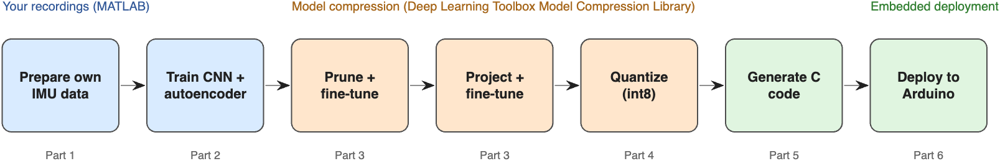
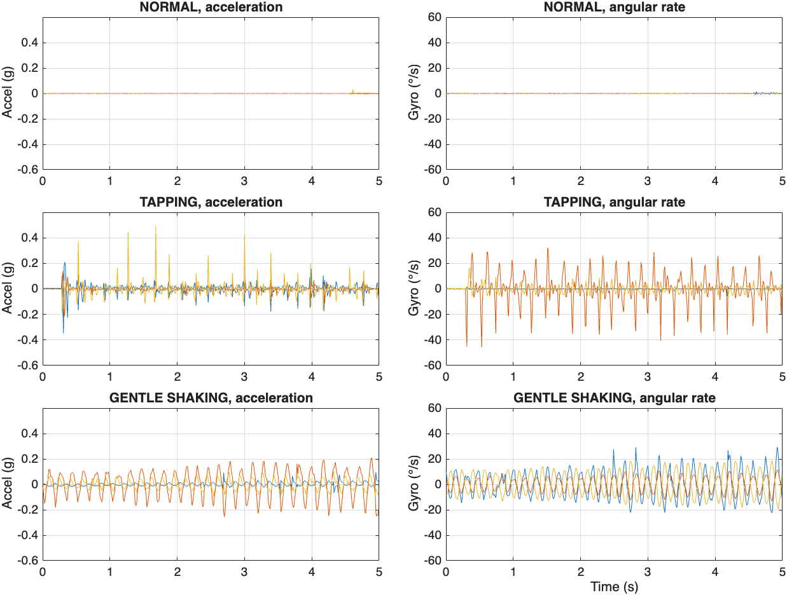

# Introduction to Embedded AI with MATLAB

::: {.callout-note title="Chapter question"}
How do we turn a MATLAB model that performs well on recorded sensor data into an embedded AI application that can reliably process real measurements on a microcontroller?
:::

## Learning objectives

After completing this chapter, you should be able to:

1. explain the difference between training in MATLAB and performing inference on an embedded target;
2. sketch the end-to-end MATLAB workflow from sensor measurements to on-device inference;
3. describe the roles of sensing, preprocessing, model training, code generation, and embedded validation;
4. identify the principal constraints on MCU inference: RAM, Flash, throughput, timing, and energy;
5. inspect real IMU recordings in MATLAB and compute an interpretable vibration feature;
6. distinguish a prototype's test-set accuracy from evidence of reliable deployment.

## 1.1 Why embedded AI?

Many sensors generate data continuously: an inertial measurement unit (IMU) on a wearable, a vibration sensor mounted on a machine, a microphone on an appliance, or a camera watching a production line. Traditionally, embedded systems have used hand-designed rules to convert these signals into actions. Machine learning adds a data-driven alternative: the system estimates patterns from examples, rather than relying on a single manually chosen threshold.

**Embedded AI** refers to performing AI-related computation on or close to the device that generates data. This location can reduce communication and the latency of a remote round trip, and it may keep raw measurements on the device. However, a microcontroller has much less memory and processing capacity than a desktop GPU. The model and its surrounding signal-processing pipeline must fit and meet a timing deadline.

Consider an Arduino Nano 33 BLE Sense Rev1 with its LSM9DS1 IMU. It captures acceleration and angular velocity. Our first application classifies the vibration of the *board itself* into three conditions: **NORMAL**, **TAPPING**, and **GENTLE_SHAKING**. These names correspond to experimental data-collection actions, not standardized industrial vibration limits. In the included project, the training data and eventual deployment use the same model of board and IMU.

{#fig-course-workflow width=93%}

*Figure @fig-course-workflow summarizes the supplied full tutorial. This introductory chapter focuses on the first three steps; later chapters will examine optimization and deployment.*

## 1.2 The MATLAB-to-device workflow

A useful development pipeline has six stages:

1. **Acquire:** record sensor data and document timestamp units, sample rate, sensor ranges, and mounting conditions.
2. **Prepare:** visualize, clean, resample, segment, and derive features using MATLAB.
3. **Train:** compare a simple baseline against a learned model, with a split that reflects independent recording sessions.
4. **Optimize:** evaluate whether quantization or compression is needed for the resource budget.
5. **Deploy:** generate compatible code or package a supported network for the selected target and integrate drivers and real-time data acquisition.
6. **Verify:** compare host and target outputs and measure inference time, RAM/Flash use, power, and robustness under different conditions.

The most important distinction is between **offline training** and **embedded inference**. Training often happens on a computer and may require many epochs. The trained model is then exported for inference, which performs predictions on new measurements. Some applications also train on-device, but that is not the default workflow in this book.

In MATLAB, typical tools include `readtable`, `timetable`, filtering and spectral-analysis routines, `fitctree` and other classification functions, `trainnet` for supported deep learning workflows, and code-generation products for supported deployment targets. Each is a tool for a different engineering step; merely having trained a network does not ensure it is compatible with embedded code generation.

## 1.3 Understanding an IMU recording

An IMU may include an accelerometer (linear acceleration, including gravity) and gyroscope (angular velocity). The supplied dataset contains six channels:

| Channel | Meaning | Units in supplied CSV |
|---|---|---|
| `ax`, `ay`, `az` | Acceleration along three sensor axes | g |
| `gx`, `gy`, `gz` | Angular velocity along three axes | degrees/s |
| `timestamp_us` | Sample time | microseconds |
| `label` | Recording condition | NORMAL / TAPPING / GENTLE_SHAKING |

The recordings come from **45 independent sessions**: 15 for each of the three conditions, with approximately 30 seconds per session. The collection nominally targets 100 samples per second, but the attached project reports occasional missing samples. Real sampling cannot always be treated as uniformly spaced: timestamps should be checked before using frequency-domain methods or constructing fixed-length windows.

In MATLAB, load a CSV and inspect its first few rows:

```{.matlab}
projectRoot = fullfile(pwd,"matlab","projects","vibration-severity-monitor");
file = fullfile(projectRoot,"data","raw","Vibration_Dataset", ...
    "TAPPING","TAPPING_001.csv");
T = readtable(file);
head(T,5)
```

The code above assumes MATLAB's working folder is the repository root. Change `projectRoot` if needed; no toolbox is required to read the CSV.

Convert the relative timestamps to seconds and plot all three acceleration axes:

```{.matlab}
t = (double(T.timestamp_us)-double(T.timestamp_us(1)))/1e6;
plot(t,[T.ax T.ay T.az]);
xlabel("Time (s)"); ylabel("Acceleration (g)");
legend("a_x","a_y","a_z"); grid on
```

{#fig-intro-signals width=92%}

### Sampling intervals

A practical first diagnostic is `diff(t)`. Its values show how far apart samples were recorded:

```{.matlab}
dt = diff(t);
fprintf("Median interval: %.3f ms\n",1000*median(dt));
fprintf("Largest interval: %.3f ms\n",1000*max(dt));
histogram(1000*dt); xlabel("Sample interval (ms)");
```

Sampling irregularity matters because a one-second window of 100 rows is not necessarily exactly one second of elapsed time. The supplied `loadRecordings` helper interpolates each complete recording onto a uniform 100 Hz grid using actual timestamps. It is suitable for the provided tutorial; for other sensors, evaluate whether interpolation obscures short transients.

## 1.4 A first physical feature: vibration RMS

The raw acceleration contains gravity, which changes when the board is tilted. A simple vibration indicator should remove each channel's mean before computing root-mean-square (RMS) amplitude. Given a matrix $X \in \mathbb{R}^{N\times 3}$ containing the three acceleration axes, define the centered signal

$$
\widetilde{X}_{i,j}=X_{i,j}-\frac{1}{N}\sum_{k=1}^{N}X_{k,j}.
$$

The combined acceleration RMS is

$$
R=\sqrt{\frac{1}{N}\sum_{i=1}^{N}\sum_{j=1}^{3}\widetilde{X}_{i,j}^{2}}.
$$ {#eq-intro-rms}

This is an *experiment-specific motion amplitude*, not a calibrated measurement of machinery vibration severity according to a formal industrial standard. In MATLAB:

```{.matlab}
a = [T.ax T.ay T.az];
aCentered = a - mean(a,1);
rmsG = sqrt(mean(sum(aCentered.^2,2)));
fprintf("Centered acceleration RMS: %.4f g\n",rmsG);
```

Why does the mean matter? A stationary board can report nearly 1 g on its vertical accelerometer axis because of gravity. Directly taking the RMS of the uncentered data would primarily measure that static component. Mean subtraction removes the constant part within the window. It is not a complete correction for changing orientation during motion, and its limitations should be discussed when interpreting results.

A second useful feature is **crest factor**, which compares the largest instantaneous amplitude with RMS. Tapping can produce brief peaks even when total energy is modest. The shape of the waveform may therefore help distinguish tapping from sustained shaking.

## 1.5 Time windows and honest evaluation

Models usually expect fixed-size inputs. At 100 Hz, a one-second window contains **100 samples**, or a `100 × 6` matrix for the six IMU channels. Windows may overlap during training to increase the number of examples. However, overlapping windows from one recording are not statistically independent.

A critical experimental rule is to **split recordings before extracting windows**. Randomly splitting individual windows can put near-duplicates or session-specific artifacts in both training and test sets, making performance look better than it is.

The supplied tutorial chooses **9 recordings per class for training, 3 per class for validation, and 3 per class for testing**. It forms overlapping training windows but non-overlapping validation/test windows. This is much stronger evidence than randomly splitting all windows, though the dataset is still small and limited to one board and recording protocol.

```{.matlab}
projectRoot = fullfile(pwd,"matlab","projects","vibration-severity-monitor");
addpath(fullfile(projectRoot,"helpers"));
dataRoot = fullfile(projectRoot,"data","raw","Vibration_Dataset");
recordings = loadRecordings(string(dataRoot),100);
summary(recordings.Class)
```

The `loadRecordings` helper interpolates onto a regular sample grid, and `splitRecordings` groups sessions before the tutorial creates windows. Complete code is provided in [Lab 1](../labs/01-vibration-severity-monitor.qmd).

## 1.6 Why start with a lightweight model?

Before using a neural network, test an interpretable baseline. The supplied project learns a shallow decision tree from log-RMS amplitude. In its documented test split, the baseline correctly classified approximately **98.85%** of the held-out windows; the original authors reported **100%** for their 1-D CNN on those windows. These are **reported results from the supplied example**, not independently repeated measurements, and the small number of independent test sessions limits what can be concluded.

A baseline tells us what extra complexity actually buys us. If a two-threshold rule is adequate, a neural network may consume memory and energy without providing enough practical gain. If taps and continuous shaking overlap in RMS, a temporal model can exploit their differing waveforms. That is a reason to compare models empirically rather than assume larger models are automatically better.

## 1.7 Embedded systems: accuracy is one metric

An embedded model is a component in a larger pipeline. Consider an application that must report once per second. With a **one-second acquisition window**, model inference must finish quickly enough to satisfy the system's scheduling and buffering assumptions. If sensing pauses during inference, the implementation may miss samples or produce windows with gaps. Double buffering can sometimes allow acquisition and inference to overlap, but it requires extra RAM.

Useful metrics include:

| Metric | How to interpret it |
|---|---|
| Accuracy / classwise recall | Does the model distinguish the required conditions? |
| Inference latency (ms/window) | How long does the deployed prediction take? |
| Flash / program storage | Can generated code and parameters fit? |
| Peak RAM | Can input buffers, activations, and application state fit? |
| Energy per prediction (J) | What is the measured energy consumed per inference? |
| Robustness to mounting changes | Does performance hold outside the recorded conditions? |

Memory used by an embedded application includes much more than neural network parameters. Input buffers, intermediate activations, the inference runtime, sensor drivers, and application code all consume space. Power consumption must be measured on the real hardware rather than inferred solely from MATLAB execution time.

## 1.8 MATLAB software and target hardware

A practical MATLAB learning environment has several layers:

- **Core MATLAB** supports CSV import, data inspection, graphics, and numerical computation.
- **Statistics and Machine Learning Toolbox** supports classical classifiers such as `fitctree`.
- **Deep Learning Toolbox** supports training and inference workflows for neural networks.
- **Code generation and deployment tools** are required for exporting supported algorithms to embedded targets. They are separate products and may require target-specific setup.
- **Hardware drivers and firmware** provide actual sensor access and time-controlled acquisition on the deployed device.

This course's first dataset comes from the **Arduino Nano 33 BLE Sense Rev1**, whose IMU is the **LSM9DS1**. **Rev2 uses different sensing hardware**; the supplied `Arduino_LSM9DS1` firmware is not a substitute for a Rev2 driver. MATLAB releases and hardware support packages also change over time. Review the current MathWorks documentation and verify your exact board and installed product versions before deployment.

## 1.9 Worked exercise: inspect motion in three conditions

Open the short MATLAB script at `matlab/fundamentals/01-inspect-vibration.m`. It reads one sample recording per class, calculates centered RMS, and compares the results. It requires only core MATLAB features for the data-inspection portion.

**Investigation:** Before running it, predict which condition will have the largest RMS and which condition may have the largest instantaneous transient relative to its RMS. Record whether the numerical results support the hypothesis.

```{.matlab}
% In MATLAB, set repoRoot to the repository root folder:
run(fullfile(repoRoot,"matlab","fundamentals","01-inspect-vibration.m"));
```

The next step is to reproduce the preprocessing and group-wise train/test split used in the full tutorial. That is the focus of Lab 1.

## Key takeaways

Embedded AI is a *complete system*, not simply a trained model. MATLAB provides a consistent environment to explore the signal, build models, and prepare suitable algorithms for deployment. Reliable results require careful treatment of sampling and recording groups, comparison with simple baselines, and validation of actual embedded timing, memory, and power.

## Exercises

1. **Conceptual:** Explain why the same classification accuracy may correspond to different embedded systems when two models have different RAM and latency requirements.
2. **Coding:** Plot `diff(timestamp_us)` for all sessions of one class. Compare medians and long-tail intervals.
3. **Experimental:** Compute centered acceleration RMS separately for `NORMAL`, `TAPPING`, and `GENTLE_SHAKING` recordings. Which classes overlap?
4. **Evaluation:** Explain why randomly distributing windows from one recording between train and test sets is a flawed test.
5. **Deployment:** Identify three hardware-related quantities that cannot be established from desktop MATLAB accuracy alone.

## Further reading

- [MathWorks: Embedded AI](https://www.mathworks.com/solutions/embedded-ai.html)
- [MATLAB Coder documentation](https://www.mathworks.com/help/coder/)
- [Deep Learning Toolbox documentation](https://www.mathworks.com/help/deeplearning/)
- [Lab 1 — Vibration Severity Monitoring](../labs/01-vibration-severity-monitor.qmd)
- Sze et al., *Efficient Processing of Deep Neural Networks: A Tutorial and Survey* [@sze2017efficient].
