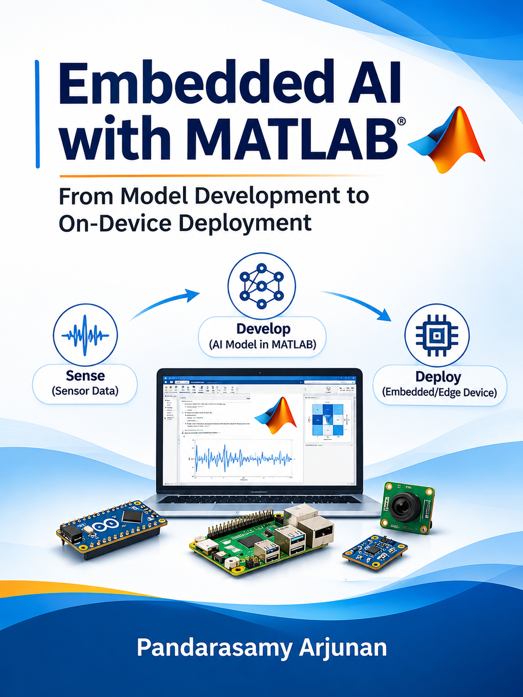

::: {.embedded-landing}

::: {.embedded-hero}

::: {.embedded-hero-copy}

# Embedded AI with MATLAB {.unnumbered}

::: {.embedded-lead}
From Model Development to On-Device Deployment
:::

::: {.embedded-description}
A hands-on, MATLAB-focused textbook and course covering sensor data acquisition, machine learning, model optimization, code generation, and deployment on embedded and edge devices.
:::

::: {.embedded-actions}
[Read the Book →](chapters/01-introduction-embedded-ai.qmd){.embedded-button .embedded-button-primary}

[Weekly Labs →](labs/weekly-lab-plan.qmd){.embedded-button}

[Preface →](preface.qmd){.embedded-button}
:::

:::

::: {.embedded-cover}
{fig-alt="Embedded AI with MATLAB book cover"}
:::

:::

## Explore the Book {.unnumbered .embedded-explore-heading}

::: {.embedded-cards}

::: {.embedded-card}
### 📘 Chapters

Learn MATLAB workflows for sensing, model development, optimization, benchmarking, and embedded deployment.

[Start Chapter 1 →](chapters/01-introduction-embedded-ai.qmd)
:::

::: {.embedded-card}
### 🧪 Weekly Labs

Follow guided MATLAB experiments with datasets, implementation exercises, and evaluation questions.

[View the Lab Plan →](labs/weekly-lab-plan.qmd)
:::

::: {.embedded-card}
### 💻 MATLAB Code & Data

Explore MATLAB scripts, project files, datasets, trained models, and supporting examples.

[Browse MATLAB Code →](https://github.com/embedded-ai-with-matlab/embedded-ai-with-matlab.github.io/tree/main/matlab)
:::

::: {.embedded-card}
### 🔧 Hands-On Project

Build a vibration severity monitor from IMU recordings to a compressed model running on an Arduino.

[Open Lab 1 →](labs/01-vibration-severity-monitor.qmd)
:::

::: {.embedded-card}
### ⚙️ Getting Started

Set up MATLAB, required toolboxes, and supported hardware for the book's examples.

[View Setup Guide →](setup.qmd)
:::

::: {.embedded-card}
### 📚 References

Find MATLAB resources, foundational research, and further embedded AI reading.

[Browse References →](references.qmd)
:::

:::

:::
