# Lab 1 — Vibration Severity Monitoring with MATLAB

::: {.callout-important title="What you will build"}
A complete embedded AI application, from raw sensor data to a running device. Using **45 real IMU recordings from an Arduino Nano 33 BLE Sense Rev1**, you train a deep learning detector in MATLAB, compress it with pruning, projection, and quantization, generate C code, and deploy it to the same board. Every second, the board reports whether it is still, vibrating lightly, or vibrating strongly, and flags vibration it does not recognize.
:::

::: {.callout-tip title="Get the code and data"}
All scripts, helper functions, the Arduino sketch, and the 45 recordings are in the project folder [`matlab/projects/vibration-severity-monitor`](https://github.com/embedded-ai-with-matlab/embedded-ai-with-matlab.github.io/tree/main/matlab/projects/vibration-severity-monitor). Clone or download the repository and open that folder in MATLAB before you start. The same tutorial is also available as a standalone repository: [`samy101/embedded-ai-with-matlab`](https://github.com/samy101/embedded-ai-with-matlab).
:::

## Why this problem?

A model is only as good as the match between its training data and the signals it sees in the field. A detector trained on someone else's dataset, with a different sensor, mounting, and environment, often reports nonsense once it runs on your own device. This mismatch, called *domain shift*, is one of the most common reasons embedded AI projects that work on a laptop fail on the device. The most reliable fix is to record the training data with the device that will run the model, and that is what you do here.

It also pays to pick a task that matters. Knowing *how strongly* something vibrates is useful in many places:

- **Machine-condition monitoring** sorts vibration into severity zones, so a technician can tell "normal" from "needs attention" before a part fails.
- **Shipping and handling** checks whether fragile goods were treated roughly in transit.
- **Measurement and lab work** needs a still surface, and a sensor can tell you when a table is not still.

Running the detector on a small sensor node avoids streaming raw vibration data to a server. The node works without a network, reports only when something changes, and can run for a long time on little power.

### Problem statement

Using 45 recordings made with the board's own IMU, build a monitor that reports every second whether the board is **still** (level 0), **vibrating lightly** (level 1), or **vibrating strongly** (level 2). It also flags vibration that fits none of these levels. The monitor shows the result on the board's RGB LED, with no computer needed after flashing.

The data and the device make this harder than it sounds:

- **Small dataset:** there are only 15 recordings per class, so the evaluation must be split by recording to give an honest estimate on new sessions.
- **Imperfect logging:** the logger occasionally missed samples, so the recordings must be resampled onto a uniform time grid.
- **Hidden shortcuts:** the classes were recorded at different board orientations, so the features must not let the model learn "tilted means shaking".
- **Overlapping classes:** a vigorous tap carries as much energy as a gentle shake, so the model must use the shape of the signal, not just its level.
- **Tight device limits:** the model must fit in a few kilobytes, run well within the one-second window on a 64 MHz microcontroller, and give the same answers as in MATLAB.

## Learning objectives

By the end of this lab, you should be able to:

1. import six-channel IMU recordings, diagnose uneven sampling, and resample them onto a uniform grid;
2. split data by recording to avoid leakage between training and test sets;
3. compare a threshold baseline with a 1-D convolutional neural network (CNN);
4. train an autoencoder on normal data only and use it to flag unfamiliar inputs;
5. read a network architecture and explain how the data size changes from layer to layer;
6. analyze a network for compression and measure the accuracy cost of pruning and projection;
7. quantize networks to 8-bit integers and compare memory and accuracy;
8. generate C code for an Arm Cortex-M microcontroller and verify it against MATLAB;
9. build, flash, and test the detector live on the board.

## Requirements

**Software**

- MATLAB R2025a or later (developed and tested with R2026b)
- Deep Learning Toolbox
- Deep Learning Toolbox Model Compression Library
- MATLAB Coder
- MATLAB Coder Interface for Deep Learning
- Embedded Coder
- Fixed-Point Designer
- Statistics and Machine Learning Toolbox
- Arduino IDE 2: the deployment script uses the `arduino-cli` included with it to install the *Arduino Mbed OS Nano Boards* core and the *Arduino_LSM9DS1* library automatically
- Simulink (optional): used only to export the classifier as a Simulink model in Step 2; without it, that export is skipped

**Hardware**

- Arduino Nano 33 BLE Sense **Rev1** (LSM9DS1 IMU)
- USB cable (data-capable, not charge-only)

**Estimated time:** one session for Steps 1–2, one session for Steps 3–4, and one session for Steps 5–6.

::: {.callout-note title="Reference results"}
The numbers and figures on this page come from a reference run on MATLAB R2026b with a Nano 33 BLE Sense Rev1. Your results can differ slightly; report the numbers from your own run.
:::

## The dataset

The data was logged from the board's LSM9DS1 IMU with the Arduino_LSM9DS1 library at a nominal 100 Hz. It contains **45 recordings** of about 30 seconds, 15 per class, in one folder per class:

| Folder | Condition | Recordings |
|---|---|---:|
| `NORMAL` | Board at rest | 15 |
| `TAPPING` | Light impulsive tapping | 15 |
| `GENTLE_SHAKING` | Sustained manual shaking | 15 |

Each CSV row holds a microsecond timestamp (`timestamp_us`), the acceleration (`ax`, `ay`, `az` in g), the angular rate (`gx`, `gy`, `gz` in degrees/s), and the `label`. Because the data was recorded with the same board and sensor that run the model, the deployed detector reads exactly the kind of signal it was trained on.

The board reports three vibration levels and one warning state:

| Level | Recorded as | Character | LED |
|---|---|---|---|
| 0, no vibration | `NORMAL` | board at rest, sensor noise only (about 0.001 g RMS) | green |
| 1, light vibration | `TAPPING` | short impulsive bursts (about 0.05 g RMS) | yellow |
| 2, strong vibration | `GENTLE_SHAKING` | sustained large motion (about 0.13 g RMS) | red |
| unrecognized | — | the classifier reports level 0 but the autoencoder disagrees for 3 s | blue |

These are teaching classes for vibration *conditions*, not ISO machine-severity grades.

## The project

The detector is a **hybrid** of two networks: a **1-D CNN classifier** that reports the vibration level, and an **autoencoder trained only on `NORMAL` data** that flags anything it does not recognize. The project folder [`matlab/projects/vibration-severity-monitor`](https://github.com/embedded-ai-with-matlab/embedded-ai-with-matlab.github.io/tree/main/matlab/projects/vibration-severity-monitor) contains one MATLAB script per stage:

| Step | Script | What it does |
|---|---|---|
| 1 | `Part1_PrepareData.m` | Load, resample, split by recording, and window the data |
| 2 | `Part2_TrainNetworks.m` | Baseline, 1-D CNN classifier, autoencoder, and architecture plots |
| 3 | `Part3a_ExploreCompression.m` | Compression analysis and accuracy-versus-compression sweeps |
| 3 | `Part3_CompressClassifier.m` | Prune and project the classifier, with fine-tuning |
| 4 | `Part4_QuantizeNetworks.m` | Quantize both networks to int8 |
| 5 | `Part5_GenerateCode.m` | Generate and verify C code for the Arm Cortex-M4 |
| 6 | `Part6_DeployToArduino.m` | Build, flash, and read the detector output from the board |

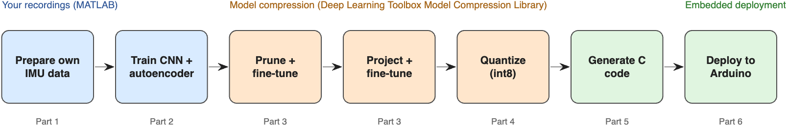{#fig-lab1-workflow width=95%}

The scripts (see the link at the top of this page) are plain-text live scripts: open them in the MATLAB Editor to see formatted text and figures inline. Run them in order, because each script loads the MAT files saved by the previous one. Each script sets its own project folder, so you can run it from anywhere:

```{.matlab}
projectRoot = fullfile(pwd,"matlab","projects","vibration-severity-monitor");   % from the repository root
run(fullfile(projectRoot,"Part1_PrepareData.m"))
```

## Step 1 — Prepare the data

Run `Part1_PrepareData.m`.

### Inspect the recordings

```{.matlab}
head(readtable(fullfile(dataFolder,"NORMAL","NORMAL_001.csv")),4)
```

```
    timestamp_us       ax           ay         az         gx         gy        gz        label
    ____________    _________    ________    _______    _______    ______    ______    __________
     1.1793e+08     -0.009888     0.01416    0.99499    0.67139    7.6904    1.5259    {'NORMAL'}
     1.1794e+08     -0.009399    0.014771    0.99524    0.79346    7.3853    1.5259    {'NORMAL'}
```

### Check the sampling

A real logger is never perfectly regular. Most sample intervals are 10 ms, but about 80 per recording are 20 ms, because the logger occasionally missed a sample.

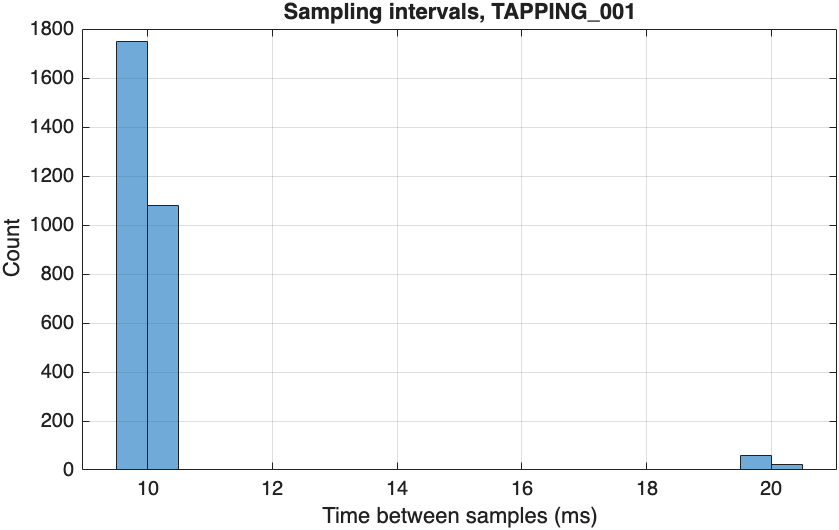{#fig-lab1-sampling width=70%}

The networks need evenly spaced samples, so the helper `loadRecordings` uses the timestamps to interpolate each recording onto a uniform 100 Hz grid. Interpolation fills the gaps smoothly; it cannot restore a transient that happened during a missed sample.

```{.matlab}
recordings = loadRecordings(dataFolder,100);
```

```
        Class         GroupCount    mean_Duration    sum_MissedSamples
    ______________    __________    _____________    _________________
    NORMAL                15           29.937              1192
    TAPPING               15           29.941              1169
    GENTLE_SHAKING        15           29.935              1181
```

### Look at the signals

Tapping produces short spikes, and shaking produces large, continuous motion on both sensors. The mean of each channel is removed so that gravity and the gyroscope bias do not hide the motion.

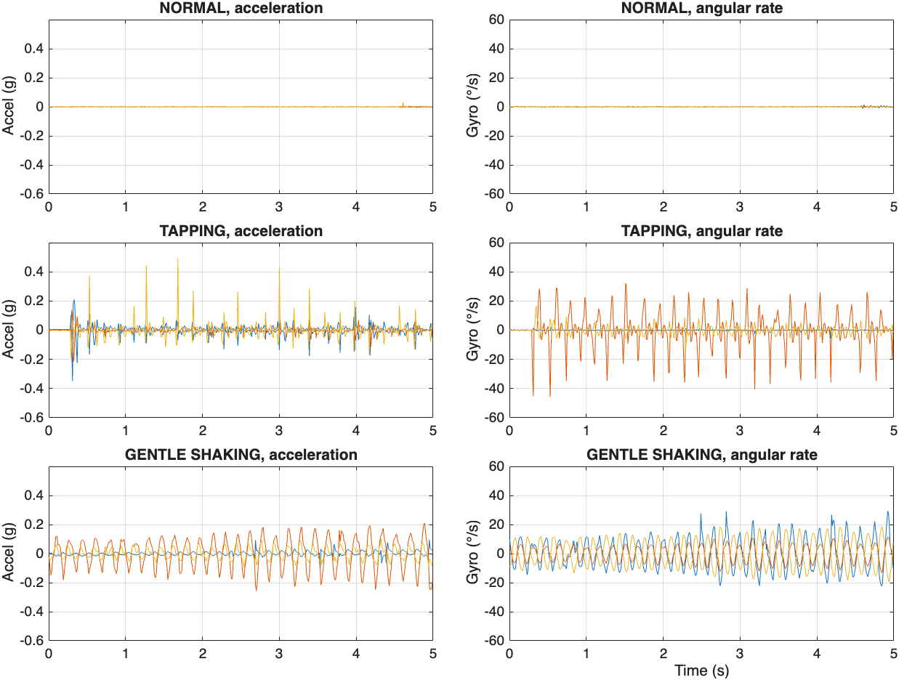{#fig-lab1-signals width=90%}

### Check the board orientation

The mean acceleration of a recording is the gravity vector, which shows how the board was oriented. The `NORMAL` recordings were made face up and face down, while the shaking recordings cover many angles.

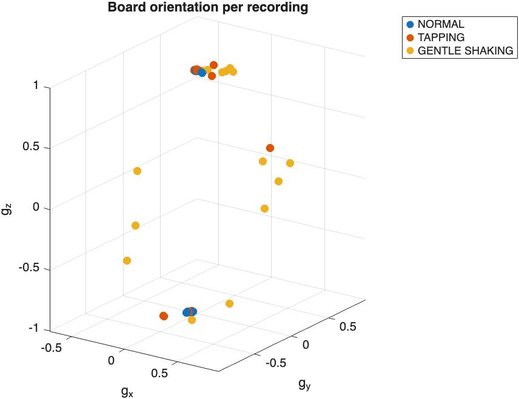{#fig-lab1-orientation width=70%}

A network that saw the raw signal could learn the shortcut "tilted board means shaking", which would fail as soon as the board is mounted differently. Every feature in this project removes the mean of each window first, so the orientation cannot be used.

### Split the data by recording

Use 9 recordings per class for training, 3 for validation, and 3 for testing. Windows from the same 30 s recording share orientation and handling, so splitting whole recordings, rather than windows, keeps the test honest.

```{.matlab}
recordingSplit = splitRecordings(recordings.Class,[9 3 3]);
```

Then cut the recordings into one-second windows of 100 samples by 6 channels. Training windows overlap by 50%; validation and test windows do not overlap.

```
numWindows =
        1566         261         261
```

### Vibration energy per class

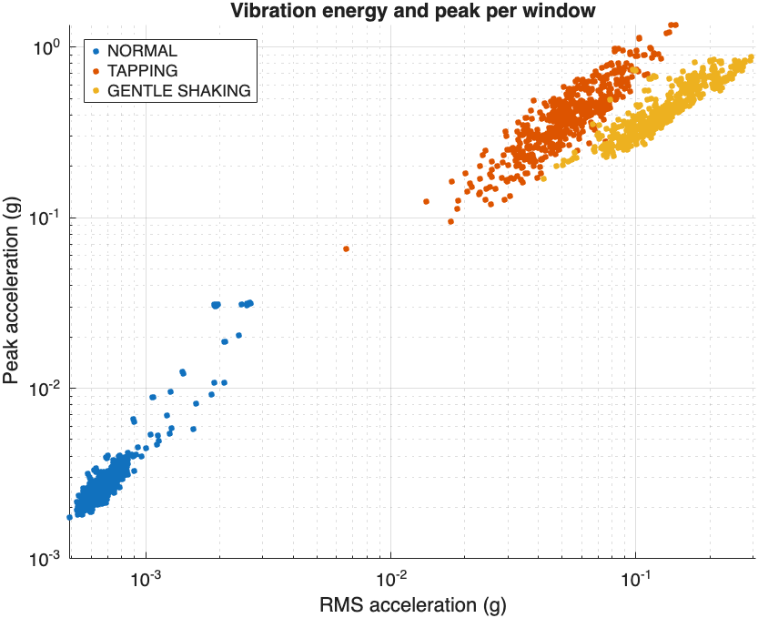{#fig-lab1-energy width=75%}

The classes are ordered by energy, but the tapping and shaking clusters touch, and at the same energy a tap has a higher peak than a shake. A single peak threshold would get the order wrong. A few `NORMAL` windows also reach about 0.03 g; Step 2 shows what they are. Part 1 saves everything to `data/preparedData.mat`.

## Step 2 — Train the networks

Run `Part2_TrainNetworks.m`. Training takes a few minutes on a laptop CPU and opens a training-progress window for each network.

### Start with a baseline

Before training a network, check what a simple rule achieves. A decision tree with two splits on the log RMS acceleration amounts to choosing two thresholds.

```{.matlab}
rmsOf = @(w) cellfun(@(x) rms(reshape(x(:,1:3) - mean(x(:,1:3)),[],1)),w);
baseline = fitctree(log10(rmsOf(windowsTrain)),labelsTrain,MaxNumSplits=2);
accuracyBaseline = 100*mean(predict(baseline,log10(rmsOf(windowsTest))) == labelsTest)
```

```
accuracyBaseline = 98.8506
```

Vibration energy alone separates most windows. Its three mistakes are vigorous taps classified as shaking: telling them apart needs the *shape* of the signal, an isolated impulse versus continuous motion.

### Train the 1-D CNN classifier

The classifier reads each window as a sequence of 100 time steps with 6 channels, after removing the mean of each channel and scaling it. It has three convolution blocks, global average pooling, and two fully connected layers. Global average pooling makes the prediction independent of *where* in the window a tap occurs.

```{.matlab}
prepare = @(w) cellfun(@(x) (x - mean(x,1))./channelScale,w,UniformOutput=false);
XTrain = prepare(windowsTrain);

layersCls = [
    sequenceInputLayer(6,MinLength=100)
    convolution1dLayer(5,16,Padding="same")
    batchNormalizationLayer
    reluLayer
    maxPooling1dLayer(2,Stride=2)
    convolution1dLayer(5,32,Padding="same")
    batchNormalizationLayer
    reluLayer
    maxPooling1dLayer(2,Stride=2)
    convolution1dLayer(3,32,Padding="same")
    batchNormalizationLayer
    reluLayer
    globalAveragePooling1dLayer
    fullyConnectedLayer(32)
    reluLayer
    fullyConnectedLayer(3)
    softmaxLayer];
netCls = trainnet(XTrain,labelsTrain,layersCls,"crossentropy",optionsCls);
accuracyCls = testnet(netCls,XTest,labelsTest,"accuracy",InputDataFormats="TCB")
```

```
accuracyCls = 100
```

Because the options include `Plots="training-progress"`, MATLAB opens a **training-progress window** while `trainnet` runs. It shows the training and validation accuracy and loss, and the settings of the run.

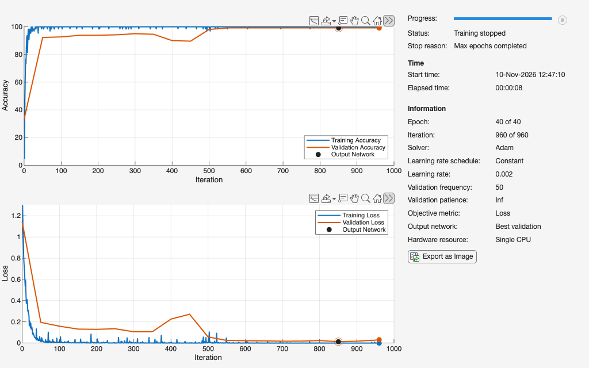{#fig-lab1-training-cls width=95%}

- **Training curves** (blue) are computed on every mini-batch, so they are noisy. The training accuracy reaches 100% within the first few epochs, and the loss falls toward zero.
- **Validation curves** (orange) are computed every 50 iterations on the 3 recordings per class held out for validation. Validation accuracy jumps to 92% after the first check and reaches 99% after about 500 iterations. The dip and bump around iterations 400–450 are a reminder that validation data is a small sample.
- **Output network** (the black dot): `OutputNetwork="best-validation"` returns the network from the check with the lowest validation loss (iteration 850, about epoch 35), not the last one.
- **What to look for:** a validation loss that stops falling or rises while the training loss keeps falling means the network has begun to memorize the training windows. Here the two curves end close together, so there is no sign of overfitting.
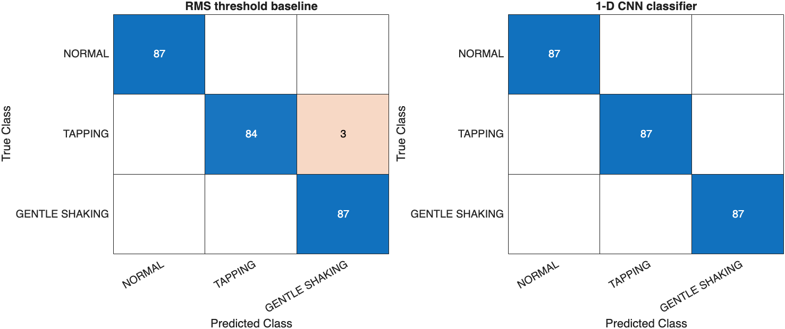{#fig-lab1-confusion width=95%}

The CNN also classifies the three boundary windows that the threshold got wrong. With only three test recordings per class, treat the exact percentage with care: it shows that the classes are well separated in new sessions, not that the model will never make a mistake.

### Look inside the classifier

The helper `plotNetworkArchitecture` draws each layer as a box. The color shows the layer type, the height grows with the number of channels, and the output size of each layer is printed below it.

```{.matlab}
plotNetworkArchitecture(netCls,[100 6],"Classifier: 1-D CNN on the 100 × 6 IMU window");
```

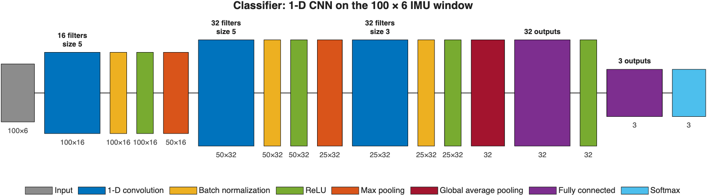{#fig-lab1-arch-cls width=100%}

The window enters as 100 × 6, the first convolution produces 16 channels, each max pooling layer halves the time axis (100 → 50 → 25), and global average pooling collapses it, so the fully connected layers see a single 32-element summary of the whole second.

### Train the autoencoder on NORMAL windows

The autoencoder learns 24 motion indicators of an undisturbed board (log RMS, crest factor, kurtosis, and high-frequency energy fraction per channel) and reconstructs them through a 6-neuron bottleneck. Any vibration makes the indicators unfamiliar and the reconstruction error large.

```{.matlab}
layersAE = [
    featureInputLayer(24)
    fullyConnectedLayer(32)
    reluLayer
    fullyConnectedLayer(6)
    reluLayer
    fullyConnectedLayer(32)
    reluLayer
    fullyConnectedLayer(24)];
netAE = trainnet(ZTrain,ZTrain,layersAE,"mse",optionsAE);
```

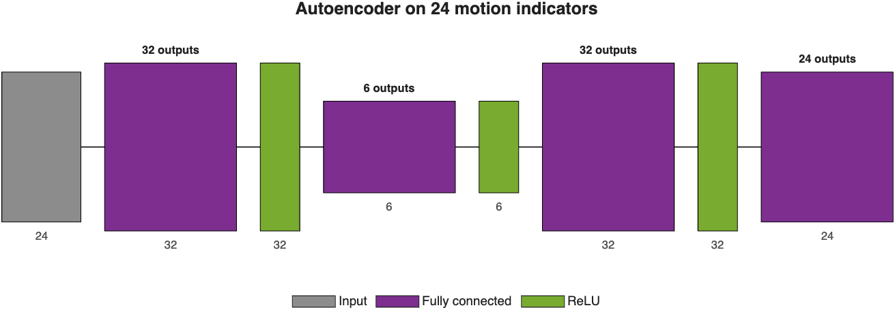{#fig-lab1-arch-ae width=80%}

The training-progress window of the autoencoder shows the mean squared error (MSE) over 300 epochs.

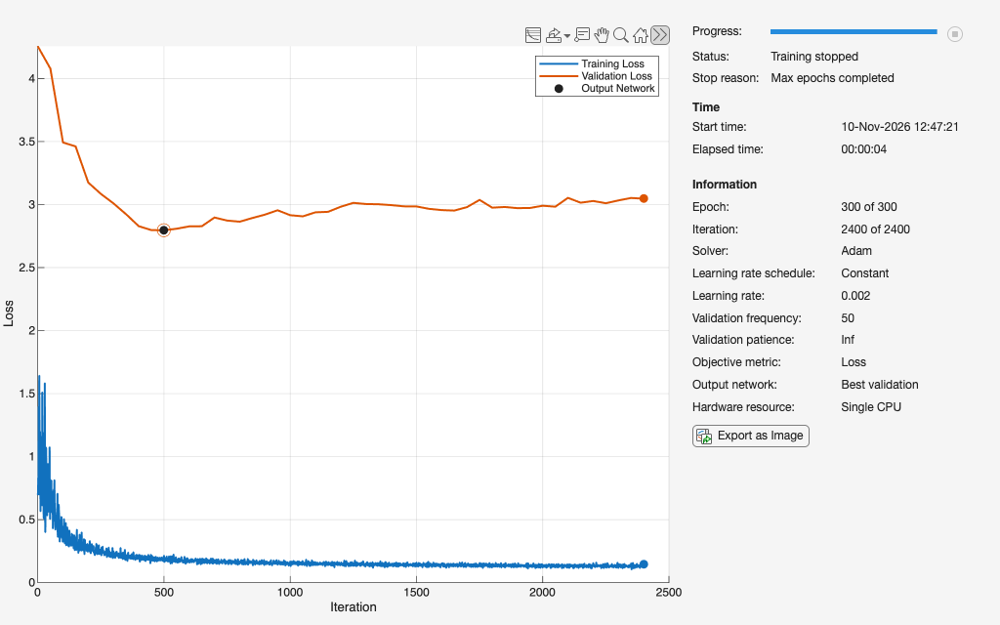{#fig-lab1-training-ae width=95%}

The training loss falls quickly and flattens near 0.15. The validation loss is about 20 times higher, and this large gap is mostly **not** overfitting. The validation loss is the *mean* error over the `NORMAL` validation windows, and a few of those windows contain small real bumps, such as a touch on the table. Their reconstruction errors are huge (the 99th percentile in the next section is 72, against a median of 0.17), so a handful of windows dominates the average while most windows are reconstructed almost perfectly. The training recordings contain fewer such bumps.

The validation loss is lowest at iteration 500 (about epoch 62) and then drifts slightly upward, a mild sign that the network is starting to fit the training windows too closely. Because of `OutputNetwork="best-validation"`, you keep the network from iteration 500 and not the one from the end of training. The gap is acceptable here because the autoencoder is judged by how *badly* it reconstructs unfamiliar windows, and the threshold in the next section is chosen to ignore these outliers.

### Choose a robust anomaly threshold

Most `NORMAL` validation windows have a tiny reconstruction error, but a few are very large:

```
prctile(scoreValNormal,[50 90 95 99]) =   0.1713    0.3543    2.5082   72.2752
```

A 99th-percentile threshold would be pulled up by these few windows. Instead, use the median plus five scaled median absolute deviations of the log score, which ignores a handful of outliers.

```{.matlab}
logScore = log10(scoreValNormal);
aeThreshold = 10^(median(logScore) + 5*1.4826*mad(logScore,1))
```

```
aeThreshold = 1.5197
```

### Find what the autoencoder found

```
        Class         GroupCount    mean_Flagged
    ______________    __________    ____________
    NORMAL                87          0.091954
    TAPPING               87                 1
    GENTLE_SHAKING        87                 1
```

The autoencoder flags every tapping and shaking window, and also 8 windows inside `NORMAL` recordings.

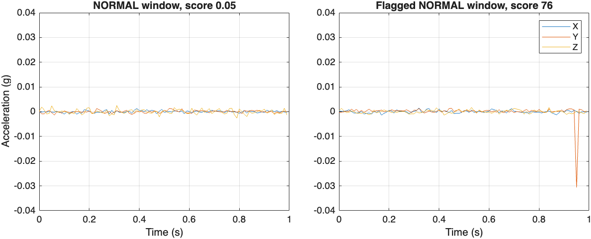{#fig-lab1-bump width=90%}

```
    NORMAL test windows    Count    Median peak (g)
    ___________________    _____    _______________
       "Not flagged"         79         0.0021334
       "Flagged"              8          0.030437
```

The flagged windows contain small real bumps, such as someone touching the table during a `NORMAL` recording. The labels describe a whole 30 s recording, but the autoencoder judges each second on its own and notices them. The classifier, trained on recording labels, calls these windows level 0; the autoencoder reports them as unrecognized vibration. This is what the hybrid design adds.

### Export the networks to Simulink

`exportNetworkToSimulink` converts a network into a Simulink model with one block per layer. With `FrameBased=true`, the model receives a whole 100 × 6 window at each time step, which the max pooling layers need. You can also inspect any network interactively with `analyzeNetwork(netCls)`.

```{.matlab}
exportNetworkToSimulink(netCls,ModelName="vibrationSeverityClassifier",FrameBased=true);
```

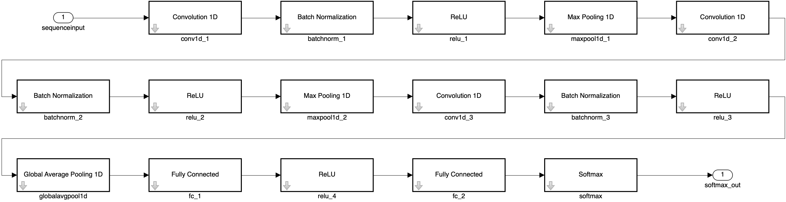{#fig-lab1-simulink-cls width=100%}

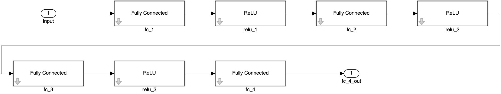{#fig-lab1-simulink-ae width=85%}

Part 2 saves both networks and the threshold to `models/baseline.mat`.

## Step 3 — Compress the classifier

A microcontroller has little memory: the Nano 33 BLE Sense has 256 KB of RAM and 1 MB of flash, shared with the operating system, the sensor driver, and the application. This step first measures how far the classifier can be compressed with `Part3a_ExploreCompression.m`, then applies the chosen recipe with `Part3_CompressClassifier.m`.

### Analyze the network for compression

Run `Part3a_ExploreCompression.m`. It starts with the report that Deep Network Designer shows when you open the network with `deepNetworkDesigner(netCls)` and click **Analyze for Compression**. The helper `exportCompressionAnalysis` shows the same report in a separate window and saves it as an image.

```{.matlab}
exportCompressionAnalysis(netCls,fullfile(projectFolder,"images","compression-analysis.png"))
```

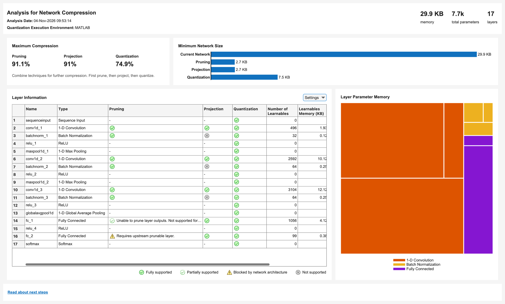{#fig-lab1-compression-report width=100%}

The report estimates that pruning alone could remove up to 91.1% of the parameter memory, projection up to 91%, and int8 quantization 74.9%. These maximums are *structural* limits: how far each technique could go if the network structure were the only constraint, regardless of accuracy.

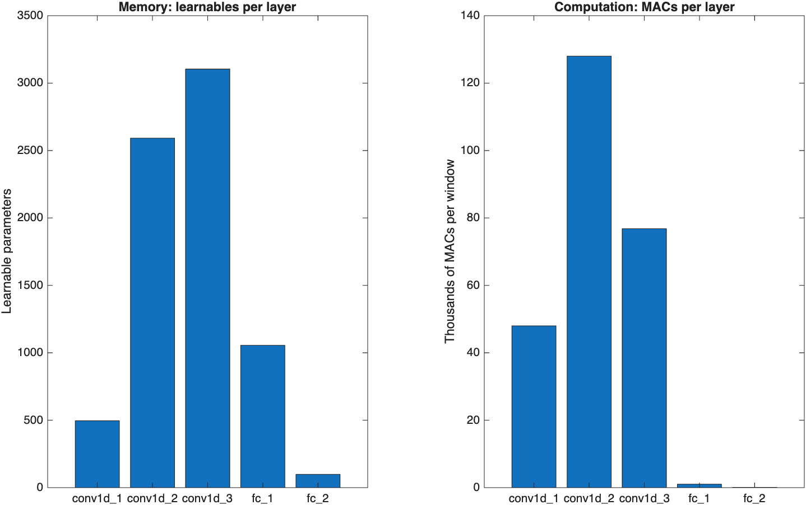{#fig-lab1-layers width=90%}

The second and third convolution layers hold most of the weights and almost all of the computation, so these are the layers where compression pays off.

### See how many directions each layer uses

Projection relies on the observation that the activations of a layer often vary along far fewer directions than the layer has neurons. `neuronPCA` computes the principal components of each layer's activations over the training data. The faster a curve rises to 100%, the more that layer can be projected without losing information.

```{.matlab}
npca = neuronPCA(netCls,mbqTrain);
```

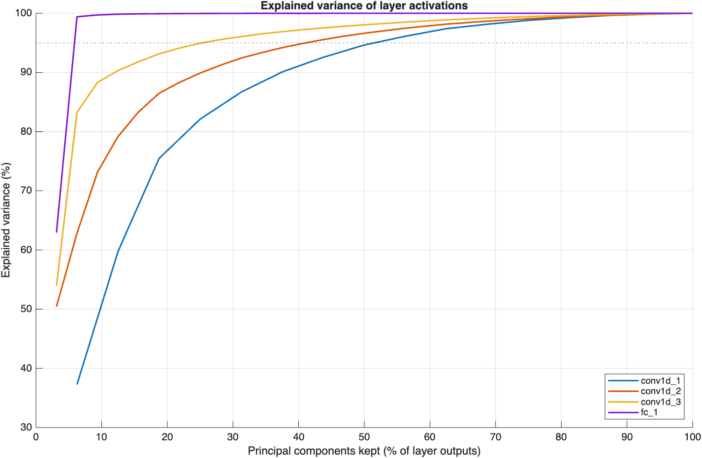{#fig-lab1-pca width=85%}

`fc_1` is extremely redundant: two of its 32 directions carry more than 99% of the variance, and `conv1d_3` reaches 95% with a quarter of its directions. Separating no, light, and strong vibration is a simple task, and the network has more capacity than it needs.

### Measure the accuracy cost of compression

The script applies each technique at increasing strength and measures the test accuracy twice: directly ("one-shot") and after 15 epochs of fine-tuning.

- **Taylor pruning** removes whole convolution filters. The helper `accumulateTaylorScores` computes the importance of every filter once, and `updatePrunables` removes the 10%, 20%, …, 90% least important ones.
- **Projection** replaces each layer with two smaller layers that keep the principal directions found by `neuronPCA`, with learnables reduction goals from 10% to 90%.

```{.matlab}
prunableNet = accumulateTaylorScores(netCls,XTrain,TTrain);
netPruned = dlnetwork(updatePrunables(prunableNet,MaxToPrune=numToPrune));
netProjected = compressNetworkUsingProjection(netCls,npca,LearnablesReductionGoal=goal);
```

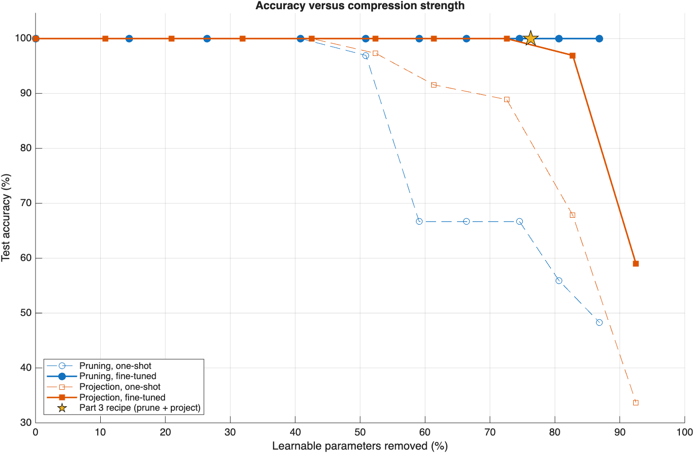{#fig-lab1-sweep width=90%}

Without fine-tuning, both techniques keep 100% accuracy up to about 40% reduction and then drop. With fine-tuning, pruning keeps 100% test accuracy all the way to 87% reduction, and projection keeps it to about 73% before it collapses. Projection breaks down earlier because it approximates every layer at once, while pruning removes whole filters but keeps the remaining ones intact.

### Prune and project the classifier

Run `Part3_CompressClassifier.m`. Following the recommended order, prune first, then project, and fine-tune after each step. First remove 50% of the learnables with Taylor pruning, in steps of 5%:

```{.matlab}
[netPruned,infoPruned] = compressNetworkUsingTaylorPruning(netCls,XTrain,TTrain,"crossentropy",optionsPruning, ...
    LearnablesReductionGoal=0.5, ...
    LearnablesReductionIncrement=0.05);
netPruned = trainnet(XTrain,TTrain,netPruned,"crossentropy",optionsFineTune);
```

```
Compressed network has 50.1% fewer learnable parameters.
Pruning compressed 5 layers: "conv1d_2","batchnorm_2","conv1d_3","batchnorm_3","fc_1"
```

Then remove a further 50% with projection and fine-tune again:

```{.matlab}
[netProjected,infoProjected] = compressNetworkUsingProjection(netPruned,XTrain, ...
    InputDataFormats="TCB", ...
    LearnablesReductionGoal=0.5);
netProjected = trainnet(XTrain,TTrain,netProjected,"crossentropy",optionsFineTune);
```

```
Compressed network has 50.2% fewer learnable parameters.
Projection compressed 4 layers: "conv1d_2","conv1d_3","fc_1","fc_2"
```

```
          Stage           Learnables    Memory (KB)    Test accuracy (%)
    __________________    __________    ___________    _________________
    Original                 7347         28.699              100
    Pruned                   3636         14.203              100
    Pruned + projected       1745         6.8164              100
```

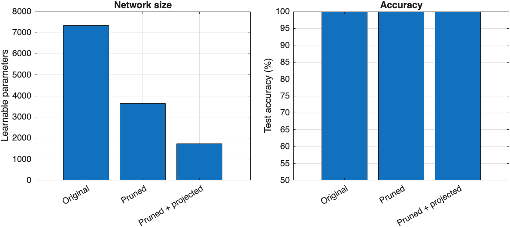{#fig-lab1-stages width=90%}

The network keeps its accuracy after a 76% reduction in learnables. The sweep shows that pruning alone could remove more, so this recipe is deliberately conservative: with only three test recordings per class, 100% test accuracy does not guarantee the same result on new recordings, and some spare capacity makes the model more robust to how the board is held or mounted.

## Step 4 — Quantize the networks

Run `Part4_QuantizeNetworks.m`. Quantization stores weights and activations as 8-bit integers with a scaling factor per tensor, which reduces parameter memory by about a factor of four and lets the microcontroller use integer arithmetic. A `dlquantizer` object with `ExecutionEnvironment="MATLAB"` targets generic C code.

```{.matlab}
quantObjCls = dlquantizer(netClsCompressed,ExecutionEnvironment="MATLAB");
prepareNetwork(quantObjCls);
calibrate(quantObjCls,arrayDatastore(XTrain(1:3:end),OutputType="same"));
netClsQ = quantize(quantObjCls,ExponentScheme="histogram");
```

The script quantizes the autoencoder the same way and recomputes the robust threshold with the quantized network (`aeThreshold = 1.4048`). The quantized autoencoder flags the same windows as the floating-point one.

```
                    Stage                    Learnables    Parameter memory (KB)    Test accuracy (%)
    _____________________________________    __________    _____________________    _________________
    Original (float32)                          7347              28.699                   100
    Pruned + projected (float32)                1745              6.8164                   100
    Pruned + projected + quantized (int8)       1705              1.9697                   100
```

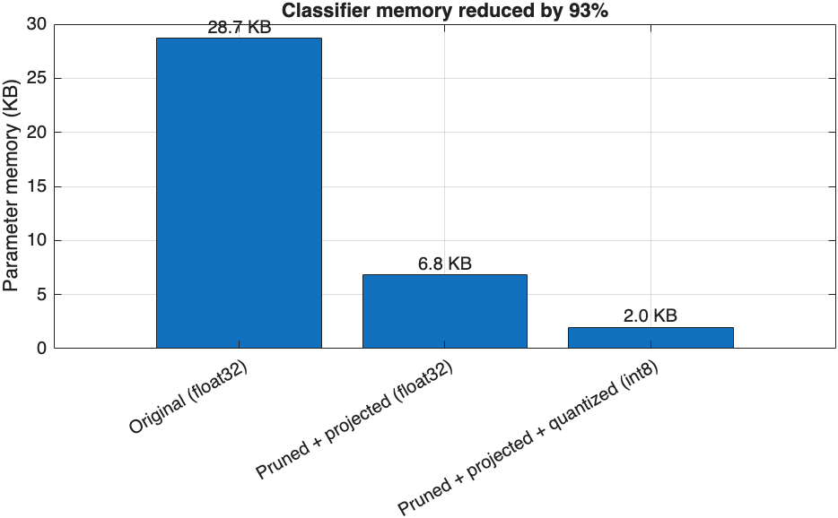{#fig-lab1-memory width=75%}

The int8 classifier needs 2.0 KB of parameter memory, a 93% reduction, and still classifies every test window correctly. Run `Part3a_ExploreCompression.m` again to place this result in the full design space: every option from the sweep at float32 and at the estimated int8 size, and the path taken through Steps 3 and 4.

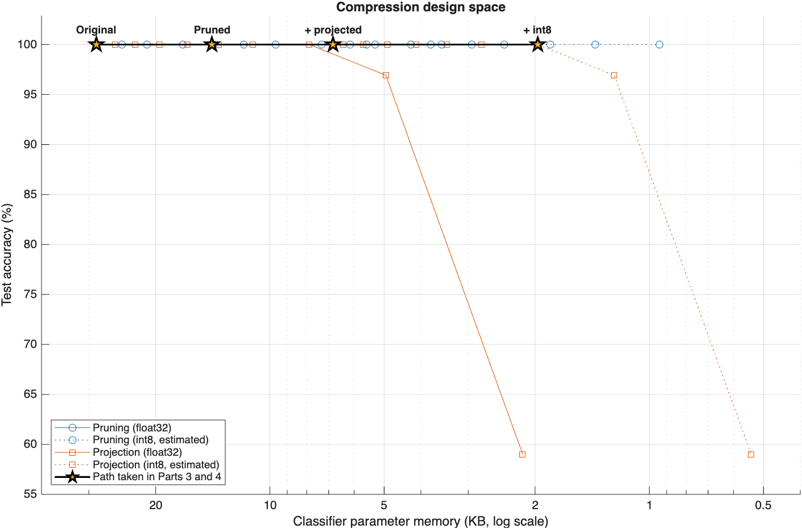{#fig-lab1-design-space width=90%}

Moving to the right means a smaller model. Every option fits easily in the board's flash, so the choice is about accuracy, inference time, and leaving room for the application. The pruning curve shows that an int8 classifier of about 1 KB would also be possible.

## Step 5 — Generate C code

Run `Part5_GenerateCode.m`. Code generation starts from the entry-point function `vibrationSeverityDetect`, which runs the complete on-device pipeline: normalization, both quantized networks, and the decision logic. It takes one 100 × 6 window and returns the level, the three class probabilities, the autoencoder score, and the unrecognized flag.

```{.matlab}
function [level,probabilities,aeScore,isUnrecognized] = vibrationSeverityDetect(window) %#codegen
persistent netCls netAE
if isempty(netCls)
    netCls = coder.loadDeepLearningNetwork("models/netClsQ.mat");
    netAE = coder.loadDeepLearningNetwork("models/netAEQ.mat");
end
params = coder.load("models/deploymentParams.mat");

x = (single(window) - mean(single(window),1)) ./ params.channelScale;
probabilities = extractdata(predict(netCls,dlarray(reshape(x',6,1,100),"CBT")));
[~,k] = max(probabilities);
level = int32(k - 1);

ci = (computeMotionIndicators(window) - params.ciMu) ./ params.ciSigma;
ciHat = extractdata(predict(netAE,dlarray(ci',"CB")));
aeScore = mean((ciHat - ci').^2);

isUnrecognized = level == 0 && aeScore > params.aeThreshold;
end
```

The classifier input is passed as a `"CBT"` formatted `dlarray`, because code generation for quantized 1-D pooling layers requires that format. Configure code generation for the microcontroller:

```{.matlab}
cfg = coder.config("lib","ecoder",true);
cfg.TargetLang = "C";
cfg.GenCodeOnly = true;
cfg.GenerateExampleMain = "DoNotGenerate";
cfg.DeepLearningConfig = coder.DeepLearningConfig(TargetLibrary="none");
cfg.HardwareImplementation.ProdHWDeviceType = "ARM Compatible->ARM Cortex-M";
cfg.LargeConstantGeneration = "KeepInSourceFiles";
cfg.EnableOpenMP = false;
cfg.EnableDynamicMemoryAllocation = false;
```

- `TargetLibrary="none"` generates plain C code with no dependency on third-party libraries.
- `LargeConstantGeneration="KeepInSourceFiles"` embeds the network weights in the C source. By default, MATLAB Coder writes large constants to binary data files, which a microcontroller without a file system cannot read.
- The `ARM Cortex-M` device type matches the word sizes and byte order of the target, and disabling dynamic memory allocation suits a microcontroller.

Before generating the library, the script builds a MEX function with the same deep learning settings and compares it with MATLAB on all 261 test windows:

```{.matlab}
codegen -config mexCfg vibrationSeverityDetect -args {zeros(100,6,"single")} -o vibrationSeverityDetect_mex
```

```
levelAgreement = 1
medianRelativeDifferenceScore = 1.4674e-07
flagAgreement = 1
```

Every level and every flag matches. Then it generates the C library and copies the `.c` and `.h` files into `arduino/VibrationSeverityMonitor/src/model`:

```{.matlab}
codegen -config cfg vibrationSeverityDetect -args {zeros(100,6,"single")} -d codegen/build -report
```

```c
extern void vibrationSeverityDetect(const float window[600], int *level,
                                    float probabilities[3], float *aeScore,
                                    bool *isUnrecognized);
```

The window is stored column by column: 100 samples of `ax`, then 100 of `ay`, and so on.

## Step 6 — Deploy to the Arduino and test live

### The Arduino sketch

The sketch `arduino/VibrationSeverityMonitor/VibrationSeverityMonitor.ino` wraps the generated code. It keeps the Arduino_LSM9DS1 library's default settings (119 Hz output data rate, ±4 g, ±2000 °/s), which match the recordings, and samples acceleration and angular rate every 10 ms. After each one-second window, it calls `vibrationSeverityDetect`, sets the RGB LED, and prints one CSV line over USB serial.

The LED shows blue only after **3 consecutive** unrecognized windows, so a single small bump, such as a knock on the desk or a touch on the USB cable, does not make it flicker. Change `kUnrecognizedWindows` to adjust this.

```c
unrecognizedCount = isUnrecognized ? unrecognizedCount + 1 : 0;
int state = (unrecognizedCount >= kUnrecognizedWindows) ? 3 : level;
```

### Build and flash

Connect the board and run `Part6_DeployToArduino.m`. It uses the `arduino-cli` included with Arduino IDE 2 to install the board core and the IMU library, compile the sketch, and upload it.

::: {.callout-tip title="Set the path to arduino-cli"}
The script contains the macOS location of `arduino-cli` inside Arduino IDE 2. On Windows or Linux, set `arduinoCli` to the equivalent path inside your Arduino IDE installation. The script picks the first `usbmodem` (macOS) or `COM` (Windows) serial port; set `port` manually if several boards are connected.
:::

```{.matlab}
arduinoCli = "/Applications/Arduino IDE.app/Contents/Resources/app/lib/backend/resources/arduino-cli";
fqbn = "arduino:mbed_nano:nano33ble";
runCli = @(args) system(sprintf('"%s" %s',arduinoCli,args));
[status,buildLog] = runCli(sprintf('compile --fqbn %s "%s"',fqbn,sketchFolder));
[status,uploadLog] = runCli(sprintf('upload --fqbn %s -p %s "%s"',fqbn,port,sketchFolder));
```

```
Sketch uses 112256 bytes (11%) of program storage space. Maximum is 983040 bytes.
Global variables use 48344 bytes (18%) of dynamic memory, leaving 213800 bytes for local variables. Maximum is 262144 bytes.
```

The complete application, including Mbed OS, the IMU driver, and both networks, uses 11% of the flash and 18% of the RAM.

### Test the monitor live

After flashing, the script reads the board's output with a `serialport` object for 30 windows and plots it. During the reference run, the board was left still, then tapped, then shaken gently, then left still again.

```{.matlab}
board = serialport(port,115200);
configureTerminator(board,"CR/LF")
fields = split(readline(board),",");
```

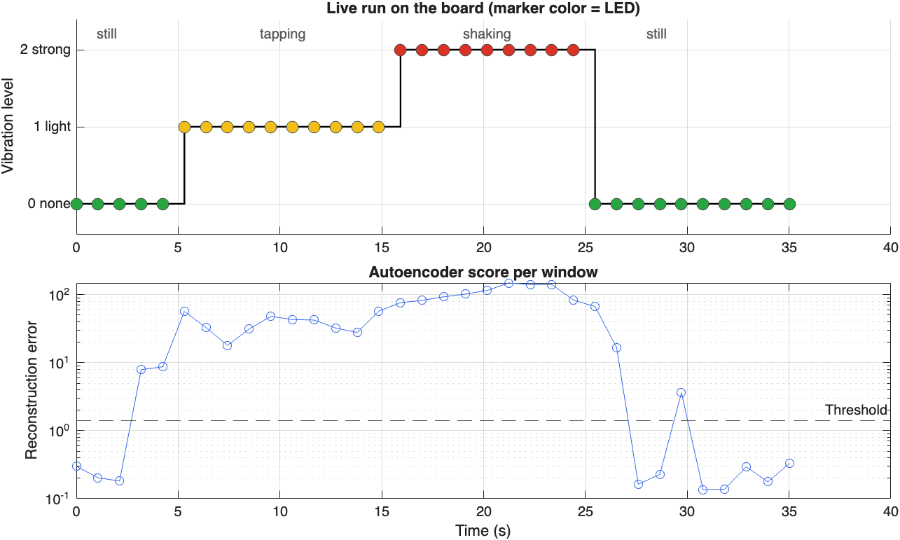{#fig-lab1-live width=90%}

| Phase | Windows | Board output |
|---|---:|---|
| Still | 5 | level 0, green |
| Tapping | 10 | level 1, yellow |
| Shaking | 9 | level 2, red |
| Still | 10 | level 0, green |

The classifier tracked every phase, with a confidence of 0.98–0.996 on all windows except the one where tapping started partway through (0.65). The autoencoder score rose above the threshold in five windows where the classifier reported level 0: two as a hand approached the board, two while the board settled after shaking, and one small bump. None lasted three windows, so the LED stayed green. Inference takes **65 ms** per window on the 64 MHz Cortex-M4F, well within the one-second window.

## Results summary

| Quantity | Reference result |
|---|---|
| RMS threshold baseline, test accuracy | 98.9% |
| 1-D CNN, test accuracy (float32 and int8) | 100% |
| Classifier parameter memory | 28.7 KB → 2.0 KB (−93%) |
| MATLAB versus generated code | identical levels and flags on 261 test windows |
| Sketch size on the board | 11% flash, 18% RAM |
| Inference time on the board | 65 ms per one-second window |
| Live test | 34 of 34 windows matched the action |

## Questions

1. Which information does the CNN use that a single RMS value discards?
2. Why can a reported 100% accuracy on three held-out recordings per class be misleading? What experiment would test generalization to a different mounting angle or a different board?
3. Why does accuracy drop so much more without fine-tuning? Why might projection collapse earlier than pruning?
4. Every compression option fits in the board's flash. What else should decide how far to compress?
5. Why must the generated code keep the weights in the source files, and why does the sketch wait for three unrecognized windows before showing blue?
6. How does the one-second window constrain the detection latency, and how could it be reduced?

## Submission checklist

- A table with class counts, recording durations, and missed samples, and a plot of the sampling intervals.
- The baseline and CNN test accuracies with their confusion charts.
- The output size of every classifier layer, and a hand calculation of the learnable parameters of one convolution layer (check it with `estimateNetworkMetrics(netCls)`).
- Your accuracy-versus-compression plot, with the reduction at which each technique first loses accuracy.
- Your memory and accuracy table after pruning, projection, and quantization.
- The MEX verification results and the sketch's flash and RAM usage.
- A plot of your live run on the board, and one page of interpretation, limitations, and next experiments.

## Extension challenge

Record five new sessions per class with a **different mounting orientation**, without adding them to training. Evaluate the original and the compressed classifier on these sessions, explain any performance drop, and test whether the most compressed network that kept full accuracy in Step 3 loses more accuracy than the original. Keep sensor settings, measurement units, and preprocessing consistent so the comparison is meaningful.

## Supporting files

| File | Description |
|---|---|
| `helpers/loadRecordings.m` | Load the CSV recordings and resample them onto a uniform grid |
| `helpers/makeWindows.m` | Cut recordings into fixed-length windows, keeping the recording index |
| `helpers/splitRecordings.m` | Stratified train/validation/test split by recording |
| `helpers/computeMotionIndicators.m` | 24 motion indicators per window (supports code generation) |
| `helpers/autoencoderScore.m` | Mean squared reconstruction error |
| `helpers/networkSummary.m` | Learnables and parameter memory of a network |
| `helpers/plotNetworkArchitecture.m` | Layer diagram with the output size of each layer |
| `helpers/exportSimulinkDiagram.m` | Picture of a network as Simulink layer blocks, arranged in rows |
| `helpers/exportCompressionAnalysis.m` | Save the Analyze for Compression report of Deep Network Designer as an image |
| `helpers/accumulateTaylorScores.m` | Taylor importance scores of all prunable filters, for pruning without retraining |
| `codegen/vibrationSeverityDetect.m` | Entry-point function for code generation |
| `arduino/VibrationSeverityMonitor/` | Arduino sketch; the generated C code is copied to `src/model/` |
| `data/raw/Vibration_Dataset/` | The 45 recordings (`NORMAL`, `TAPPING`, `GENTLE_SHAKING`) |
