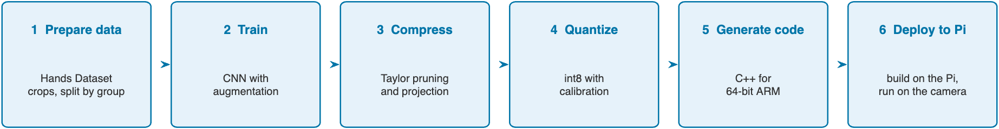
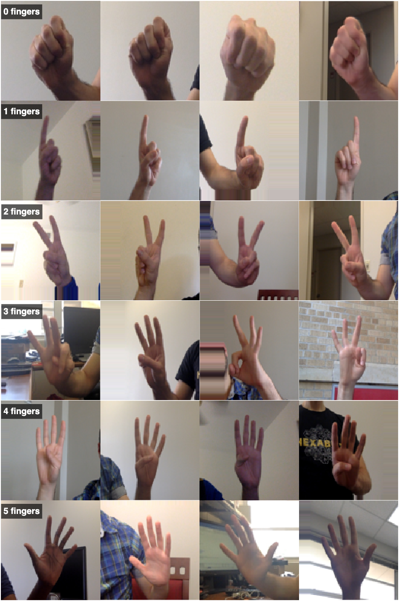
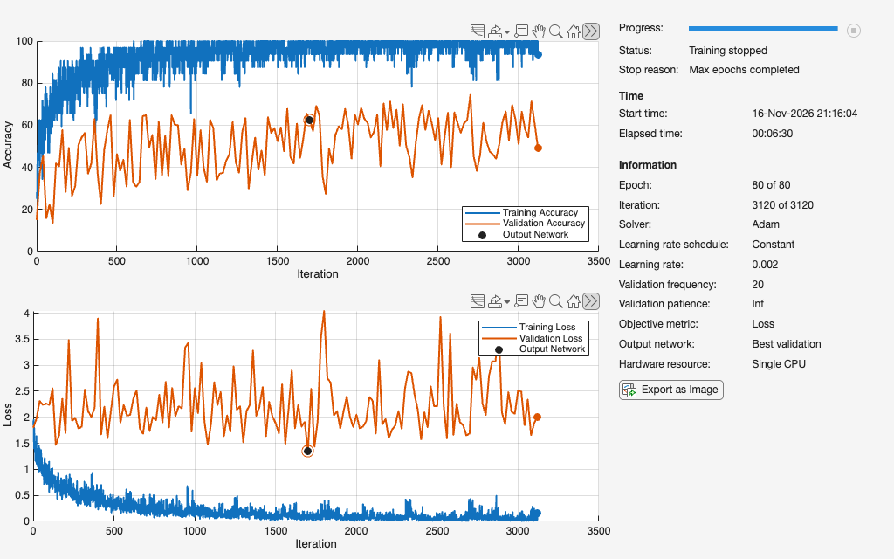
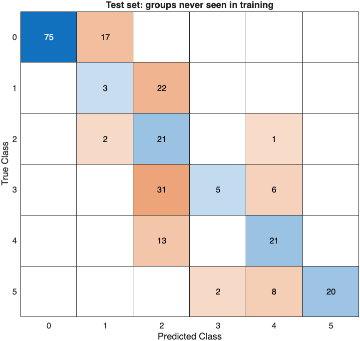
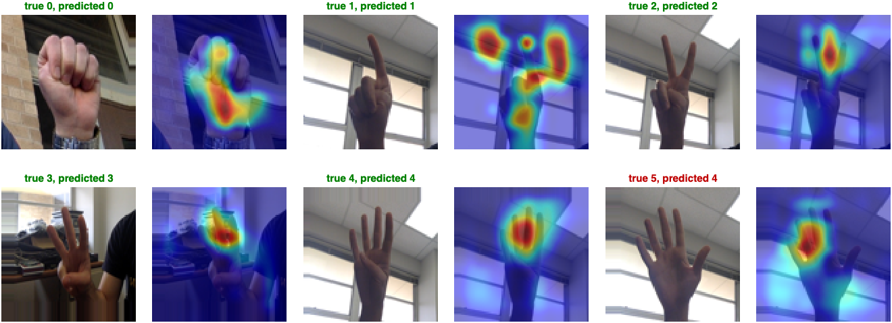
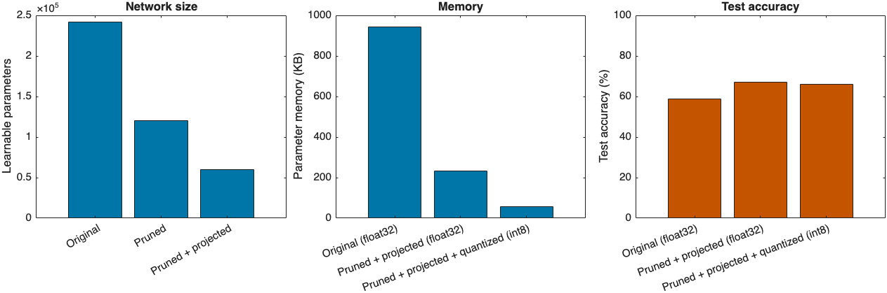
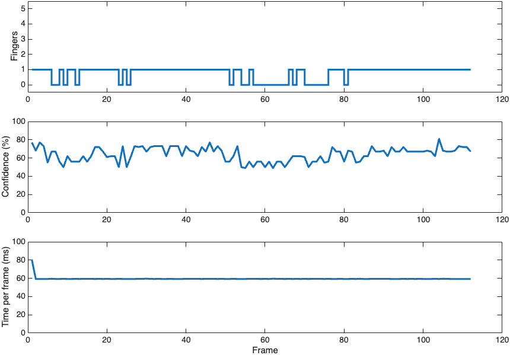

# Lab 2 — Finger Counting on a Raspberry Pi with MATLAB

::: {.callout-important title="What you will build"}
An image classifier that runs on a **Raspberry Pi 5**. The Pi camera sees a hand, and the Pi reports how many fingers are held up, from 0 to 5. You prepare a public dataset of hands, train a convolutional neural network (CNN) in MATLAB, compress it with pruning, projection, and quantization, generate C++ code, and build and run the program on the Pi, all from MATLAB with the Raspberry Pi Blockset.
:::

::: {.callout-tip title="Get the code and data"}
All scripts, helper functions, and the code for the Pi are in the project folder [`matlab/projects/finger-counting-on-raspberry-pi`](https://github.com/embedded-ai-with-matlab/embedded-ai-with-matlab.github.io/tree/main/matlab/projects/finger-counting-on-raspberry-pi). The photos come from the public [Hands Dataset](https://github.com/SubhiH/HandsDataset) (Apache License 2.0), which Part 1 downloads for you. The same tutorial is also available as a standalone repository: [`samy101/embedded-ai-with-matlab`](https://github.com/samy101/embedded-ai-with-matlab).
:::

## Why this problem?

Cameras are now in every phone, laptop, and kiosk, and a hand is the simplest controller there is: it is always with you, and it needs no touch. Counting the fingers that someone holds up is a small, clear version of a larger family of tasks: gesture control of a display or a machine, touch-free interfaces in places where hands are dirty or gloved, and learning games for children.

Running the model on the board next to the camera, instead of sending the video to a computer or a server, has three advantages. The video never leaves the device, which matters for privacy. The answer comes back in a fraction of a second, with no network delay. And the device keeps working without a network. A Raspberry Pi 5 is powerful enough to do this with a small network, but it still has limited memory and no graphics card, so the model must be small and the code efficient.

### Problem statement

Using 1,730 labeled hands from a public dataset, build a program that runs on a Raspberry Pi 5 and, for every camera frame, reports how many fingers are held up (0 to 5), with the confidence of the answer.

The data and the device make this harder than it sounds:

- **Photos of one kind, a camera of another:** the training photos were taken with a different camera, in different rooms, so the model has to cope with a new camera and a new background.
- **Small dataset with groups:** photos from one recording look alike, so the evaluation must be split by recording group to give an honest estimate.
- **Unbalanced classes:** there are twice as many fists as hands with 1 to 4 fingers.
- **Shortcuts:** about 100 photos of 5 fingers come from a different source than the rest, which a network could use as a shortcut.
- **Limited device:** the model must be small, run well within a frame time on the Pi, and give the same answers as in MATLAB.

## Learning objectives

By the end of this lab, you should be able to:

1. prepare an image dataset for classification: crop labeled regions, resize them, and split by recording group;
2. train a CNN with image augmentation, and read the training and validation curves;
3. judge a model with a confusion chart, the accuracy of each class, and Grad-CAM;
4. analyze the effect of pruning and projection on the size and accuracy of a network;
5. quantize a network to 8-bit integers and compare memory and accuracy;
6. generate C++ code from MATLAB and verify it against MATLAB;
7. connect to a Raspberry Pi from MATLAB, read its camera, and build and run a stand-alone program on it;
8. explain why a good test accuracy on one dataset does not guarantee that the model works on your own camera.

## Requirements

**Software**

- MATLAB R2026b
- Deep Learning Toolbox
- Deep Learning Toolbox Model Compression Library
- MATLAB Coder
- MATLAB Coder Interface for Deep Learning
- Embedded Coder
- Statistics and Machine Learning Toolbox
- Raspberry Pi Blockset (from the Add-On Explorer)

**Hardware**

- Raspberry Pi 5 with Raspberry Pi OS or Debian 13 (64-bit), connected to the same network as your computer
- Raspberry Pi Camera Module (tested with Camera Module 3)

The first connection installs a small MATLAB server on the Pi and may ask you to run `raspisetup`, which installs some Linux packages.

**Estimated time:** one session for Steps 1–2, one session for Steps 3–4, and one session for Steps 5–6.

## Our approach: a small CNN, compressed and run on the Pi

A small CNN reads a 96 × 96 color image of a hand and predicts one of six classes. After training, the network is compressed and quantized, and MATLAB Coder turns it into C++ code that the Pi compiles and runs. The project folder contains one MATLAB script per stage:

| Step | Script | What it does |
|---|---|---|
| 1 | `Part1_PrepareData.m` | Download the dataset, cut out the hands, and split by recording group |
| 2 | `Part2_TrainNetworks.m` | Train the CNN with augmentation, test it, and look at it with Grad-CAM |
| 3 | `Part3_CompressClassifier.m` | Prune and project the network, with fine-tuning |
| 4 | `Part4_QuantizeNetwork.m` | Quantize the network to int8 |
| 5 | `Part5_GenerateCode.m` | Generate C++ code and verify it against MATLAB |
| 6 | `Part6_DeployToRaspberryPi.m` | Build the program on the Pi and run it on the camera |

{#fig-lab2-workflow width=100%}

The scripts are plain-text live scripts: open them in the MATLAB Editor to see formatted text and figures inline. Run them in order, because each script loads the MAT files saved by the previous one.

## Step 1 — Prepare the data

Run `Part1_PrepareData.m`. The [Hands Dataset](https://github.com/SubhiH/HandsDataset) has about 1,550 webcam photos of 800 × 600 pixels. Each photo has rectangles around hands, and each rectangle is labeled with the number of open fingers. The photos show a person's face, so they are not part of this repository: `downloadHandsDataset` downloads them from GitHub (about 430 MB) the first time.

```{.matlab}
labelsTable = [readtable(fullfile(datasetFolder,"data","train_labels.csv")); ...
    readtable(fullfile(datasetFolder,"data","test_labels.csv"))];
labelsTable.Fingers = categorical(extractBefore(string(labelsTable.class),"-"));
countsPerClass = countcats(labelsTable.Fingers)'
```

```
countsPerClass =
   503   232   221   225   210   339
```

There are 1,730 labeled hands in 1,557 photos. The dataset was made for object detection, but a classifier does not need to find the hand. `cropHand` makes each rectangle square, adds a 20% margin so that the fingertips are not cut off, and resizes it to 96 × 96 pixels.

```{.matlab}
X(:,:,:,k) = cropHand(img,box,96,0.2);
```

{#fig-lab2-hands width=65%}

### Split the data by group

The photo names start with a recording group, for example `996_pic00012.jpg`. Photos of one group show the same room, the same light, and the same person. If photos of one group were in both the training and test sets, the test would be too easy, so **whole groups** go to one set. About 100 photos of 5 fingers have names without a group; they come from a different source, so they get their own group, `other`, and stay in the training set.

```{.matlab}
group = extractBefore(string(labelsTable.filename),"_pic");
group(ismissing(group)) = "other";
isTest = ismember(group,["996" "5"]);
isVal = ismember(group,["26" "3_1528505750.77" "15"]);
isTrain = ~isTest & ~isVal;
```

```
             fingers_0    fingers_1    fingers_2    fingers_3    fingers_4    fingers_5
Training        314          184          172          153          142          291
Validation       97           23           25           30           34           18
Test             92           25           24           42           34           30
```

Every set contains all six classes: 1,256 hands for training, 227 for validation, and 247 for testing. The validation and test sets are small, and they contain many more fists than other hands. All hands of the `other` group are 5-finger hands, a shortcut that a network could learn ("this photo style means 5").

## Step 2 — Train the network

Run `Part2_TrainNetworks.m`. The network has four convolution blocks. Each one finds simple patterns (edges, then finger shapes), and each pooling layer halves the width and height. Global average pooling makes the prediction independent of where in the image the hand is, and dropout switches off some neurons at random during training, which helps with only about 1,200 training images.

```{.matlab}
layers = [
    imageInputLayer([96 96 3],Normalization="none")
    convolution2dLayer(3,32,Padding="same")
    batchNormalizationLayer
    reluLayer
    maxPooling2dLayer(2,Stride=2)
    convolution2dLayer(3,64,Padding="same")
    batchNormalizationLayer
    reluLayer
    maxPooling2dLayer(2,Stride=2)
    convolution2dLayer(3,128,Padding="same")
    batchNormalizationLayer
    reluLayer
    maxPooling2dLayer(2,Stride=2)
    convolution2dLayer(3,128,Padding="same")
    batchNormalizationLayer
    reluLayer
    globalAveragePooling2dLayer
    dropoutLayer(0.3)
    fullyConnectedLayer(6)
    softmaxLayer];
```

A hand in a new room differs from the training photos: it is a little rotated, closer, or off-center. Random rotation, scaling, and shifting of the training images teach the network to cope with this. Mirroring is left out, because it did not help in our tests.

```{.matlab}
augmenter = imageDataAugmenter(RandRotation=[-15 15],RandScale=[0.9 1.1], ...
    RandXTranslation=[-8 8],RandYTranslation=[-8 8]);
dsTrain = augmentedImageDatastore([96 96 3],XTrain,labelsTrain,DataAugmentation=augmenter);
[net,info] = trainnet(dsTrain,layers,"crossentropy",options);
```

MATLAB opens the **training-progress window** while `trainnet` runs. On a laptop CPU, the 80 epochs take a few minutes.

{#fig-lab2-training width=95%}

This is the most important figure of the lab. The network learns the training photos almost perfectly, but it is judged on recording groups it has never seen, and there it is unsteady. The validation set is small and its hands are different from the training hands, so the curve is noisy. `OutputNetwork="best-validation"` returns the network from the check with the lowest validation loss (the black dot), not the last one. Even then, a second run with the same seed gave a different network, so treat any single accuracy number with care.

```{.matlab}
accuracyTest = testnet(net,XTest,labelsTest,"accuracy")
```

```
accuracyTest = 58.7045
```

{#fig-lab2-confusion width=60%}

The test accuracy is 58.7%, with very uneven results for each class (81.5%, 12.0%, 87.5%, 11.9%, 61.8%, and 66.7% for 0 to 5 fingers). The test set has only 247 hands from two recording groups, and the same network trained with another seed scored anywhere between about 40% and 70%. A small dataset gives an unstable estimate.

### See what the network looks at

**Grad-CAM** highlights the pixels that raised the score of the predicted class. If the network has learned to count fingers, the bright areas should lie on the fingers.

```{.matlab}
map = gradCAM(net,XTest(:,:,:,idx),predicted(idx));
```

{#fig-lab2-gradcam width=100%}

## Step 3 — Compress the network

A Raspberry Pi 5 has plenty of memory, but a smaller network still loads faster, uses less memory bandwidth, and runs faster. Run `Part3_CompressClassifier.m`. **Taylor pruning** removes the convolution filters that matter least, and **projection** replaces each layer with two smaller layers that keep its principal directions. Each step is followed by fine-tuning with the same augmentation as in Step 2.

```{.matlab}
[netPruned,infoPruned] = compressNetworkUsingTaylorPruning(net,XTrain,labelsTrain,"crossentropy",optionsPruning, ...
    LearnablesReductionGoal=0.5,LearnablesReductionIncrement=0.05);
netPruned = trainnet(dsTrain,netPruned,"crossentropy",optionsFineTune);

[netProjected,infoProjected] = compressNetworkUsingProjection(netPruned,XTrain,LearnablesReductionGoal=0.5);
netProjected = trainnet(dsTrain,netProjected,"crossentropy",optionsFineTune);
```

```
          Stage           Learnables    Memory (KB)    Test accuracy (%)
    __________________    __________    ___________    _________________
    Original                241610        943.77            58.70
    Pruned                  120180        469.47            80.57
    Pruned + projected       59496        232.41            67.21
```

The network now needs about a quarter of the parameter memory. Do not read too much into the accuracy column: the test set is small, and fine-tuning is also extra training, so a compressed network can even score higher than the original, as the pruned network does here. What the table shows reliably is the reduction in size.

## Step 4 — Quantize the network

Run `Part4_QuantizeNetwork.m`. Quantization stores the weights and activations as 8-bit integers, which reduces the parameter memory by about a factor of four. A calibration step runs training images through the network to find the range of values in every layer.

```{.matlab}
quantObj = dlquantizer(netCompressed,ExecutionEnvironment="MATLAB");
prepareNetwork(quantObj);
calibrate(quantObj,augmentedImageDatastore([96 96 3],XTrain(:,:,:,1:3:end)));
netQ = quantize(quantObj,ExponentScheme="histogram");
```

```
                    Stage                    Learnables    Parameter memory (KB)    Test accuracy (%)
    Original (float32)                          241610           943.77                  58.70
    Pruned + projected (float32)                 59496           232.41                  67.21
    Pruned + projected + quantized (int8)        57832            57.78                  65.99
```

The int8 network gives the same answer as the float network for 91.9% of the test hands.

{#fig-lab2-compression width=100%}

## Step 5 — Generate C++ code

Run `Part5_GenerateCode.m`. Code generation starts from the entry-point function `fingerCountDetect`. It takes a 480 × 640 camera frame, prepares it with `preprocessFrame` (the same function that prepared the training images), runs the quantized network, and returns the number of fingers and the six probabilities.

```{.matlab}
function [count,probabilities] = fingerCountDetect(frame) %#codegen
persistent net
if isempty(net)
    net = coder.loadDeepLearningNetwork("models/netQ.mat");
end
x = preprocessFrame(frame);                                  % 96 x 96 x 3, values 0 to 1
probabilities = extractdata(predict(net,dlarray(x,"SSCB")));
[~,k] = max(probabilities);
count = int32(k - 1);
end
```

The input is labeled `"SSCB"` (spatial, spatial, channel, batch): code generation for quantized pooling layers requires the batch dimension, even for a single image. `preprocessFrame` keeps the centered 480 × 480 square of the frame and averages 5 × 5 blocks of pixels to get 96 × 96, using only basic array operations, so MATLAB and the Pi prepare the images in exactly the same way.

Before generating code for the Pi, the script builds a MEX function with the same deep learning settings and compares it with MATLAB on all 247 test hands:

```{.matlab}
mexCfg = coder.config("mex");
mexCfg.DeepLearningConfig = coder.DeepLearningConfig(TargetLibrary="none");
mexCfg.LargeConstantGeneration = "KeepInSourceFiles";
codegen -config mexCfg fingerCountDetect -args {zeros(480,640,3,"uint8")} -o fingerCountDetect_mex
```

```
countAgreement = 1
medianRelativeDifference = 0
```

Every count matches, and the probabilities are identical. Then it generates the C++ library for a 64-bit ARM processor:

```{.matlab}
cfg = coder.config("lib");
cfg.TargetLang = "C++";
cfg.GenCodeOnly = true;
cfg.DeepLearningConfig = coder.DeepLearningConfig(TargetLibrary="none");
cfg.LargeConstantGeneration = "KeepInSourceFiles";
cfg.HardwareImplementation.ProdHWDeviceType = "ARM Compatible->ARM 64-bit (LP64)";
codegen -config cfg fingerCountDetect -args {zeros(480,640,3,"uint8")} -d codegen/lib -report
```

- `TargetLibrary="none"` generates plain C++ code with no dependency on third-party libraries.
- `LargeConstantGeneration="KeepInSourceFiles"` embeds the network weights in the C++ source files, so the program does not depend on separate data files.

## Step 6 — Deploy to the Raspberry Pi and run it

### Connect to the board

Run `Part6_DeployToRaspberryPi.m`. Define the connection details in the Command Window, so that your password is never saved in a script, and connect with `raspi`.

```{.matlab}
piAddress = "raspberrypi.local";
piUser = "pi";
piPassword = "...";            % type your password in the Command Window only
r = raspi(piAddress,piUser,piPassword)
```

### Check the camera view

The network sees the centered square of the camera frame, so hold your hand inside it, with the fingers spread out and clearly visible, the way the hands in the training photos were.

```{.matlab}
cam = cameraboard(r,"Resolution","640x480");
frame = snapshot(cam);
imshow(frame)
rectangle(Position=[81 1 480 480],EdgeColor="g",LineWidth=3)
clear cam          % the camera can be used by only one program at a time
```

### Build the program on the Pi

`fingerCounterApp` is the program for the Pi. It creates the camera, then grabs frame after frame and calls `fingerCountDetect` on each, until it is stopped.

```{.matlab}
function fingerCounterApp() %#codegen
r = raspi;
cam = cameraboard(r,"Resolution","640x480");
k = int32(0);
while true
    k = k + 1;
    frame = snapshot(cam);
    t0 = tic;
    [count,probabilities] = fingerCountDetect(frame);
    ms = toc(t0)*1000;
    fprintf("frame %2d: %d fingers  (confidence %3.0f%%, %5.1f ms)\n",k,count,100*max(probabilities),ms);
end
end
```

Configure code generation for a stand-alone program on a 64-bit Raspberry Pi. MATLAB generates the C++ code on your computer, copies it to the Pi, and builds it there with the compiler on the Pi. The board type must match the operating system: `Raspberry Pi (64bit)` for a 64-bit system, and `Raspberry Pi` for a 32-bit system. MATLAB warns that the program does not end: that is intended.

```{.matlab}
hw = coder.hardware("Raspberry Pi (64bit)");
hw.DeviceAddress = r.DeviceAddress;  hw.Username = piUser;  hw.Password = piPassword;
hw.BuildDir = "/home/" + piUser + "/MATLAB_ws/fingercounter";
cfg = coder.config("exe");
cfg.Hardware = hw;
cfg.GenerateExampleMain = "GenerateCodeAndCompile";
cfg.DeepLearningConfig = coder.DeepLearningConfig(TargetLibrary="none");
cfg.LargeConstantGeneration = "KeepInSourceFiles";
codegen -config cfg fingerCounterApp -d codegen/pi -report
```

### Run it on the camera

Start the program on the board for 20 seconds. Hold up your hand in front of the camera and change the number of fingers every few seconds. The `timeout` command stops the program, and `stdbuf -oL` sends each line as soon as it is printed.

```{.matlab}
program = strtrim(string(system(r,"find /home/" + piUser + "/MATLAB_ws/fingercounter -name fingerCounterApp.elf | head -1")));
output = system(r,"cd '" + fileparts(program) + "' && stdbuf -oL timeout 20 ./fingerCounterApp.elf 2>/dev/null; true");
disp(output)
```

```
frame  1: 1 fingers  (confidence  96%,  60.1 ms)
frame  2: 1 fingers  (confidence  97%,  59.3 ms)
frame  3: 1 fingers  (confidence  96%,  59.5 ms)
...
```

{#fig-lab2-live width=85%}

The network and the preparation of the frame take about 60 ms per frame on the Pi 5, and about 15 frames per second go through the whole loop, including the camera. The program is 227 KB, and it uses about 51 MB of memory while it runs, including the camera libraries.

To use it live without a time limit, open a terminal on your computer, log in to the Pi with `ssh`, go to the program folder, and start `./fingerCounterApp.elf 2>/dev/null`. Each line appears while the program runs, and Ctrl+C stops it.

::: {.callout-warning title="Read these results with care"}
There is no "no hand" class: the network always answers with a number from 0 to 5, and it can be confident about it even when the camera sees only the ceiling, as in the run above. The network was trained on tight crops around a hand, so it works best when the hand fills most of the green square. And the accuracy of 59–67% on held-out recording groups says that a new camera, a new room, and your own hand can make it worse or better: try 0 to 5 fingers and count how often it is right.
:::

## Results summary

| Quantity | Reference result |
|---|---|
| Test accuracy, float network (247 hands, groups never seen) | 58.7% |
| Test accuracy, pruned and projected / int8 | 67.2% / 66.0% |
| Parameter memory | 944 KB → 58 KB (−94%) |
| MATLAB versus generated code (MEX) | identical counts on all 247 test hands |
| Program size on the Pi | 227 KB |
| Peak memory of the program on the Pi | about 51 MB |
| Time per frame on the Pi (preparation and network) | about 60 ms |

## Extension challenge

Record your own images with the Pi camera: `captureFingerSession` (in the `helpers` folder) counts you down and saves images for each finger count through `cameraboard`. Record at least five sessions with different light, backgrounds, and hands, and keep one session out of training as the test. Add the images to Part 1, train again, and compare the accuracy on your own test session with the 59–67% of the public dataset. Then add a "no hand" class with photos of empty scenes, so that the network can say "nothing".

## Where to go next

- **Transfer learning:** start from a pretrained network such as MobileNet-v2 (a support package in the Add-On Explorer), which needs far fewer images to reach a stable accuracy.
- **More classes:** recognize other hand shapes, such as the gestures of rock, paper, and scissors.
- **Faster:** try the most compressed networks of Step 3 and measure the time per frame on the Pi.
- **Another board:** the same workflow applies to other boards that MATLAB supports; keep the preprocessing the same in training and on the device.
