# Lab 3 — Reading Handwritten Digits on a Raspberry Pi with MATLAB

::: {.callout-important title="What you will build"}
A handwritten-digit reader that runs on a **Raspberry Pi 5**. You write a digit on a sheet of paper and hold it in front of the Pi camera, and the Pi reports which digit it is, from 0 to 9, or "no digit" for blank paper. You train a convolutional neural network (CNN) in MATLAB, compress it with pruning, projection, and quantization, generate C++ code, and build and run the program on the Pi, all from MATLAB with the Raspberry Pi Blockset.
:::

::: {.callout-tip title="Get the code and data"}
All scripts, helper functions, and the code for the Pi are in the project folder [`matlab/projects/digit-recognition-on-raspberry-pi`](https://github.com/embedded-ai-with-matlab/embedded-ai-with-matlab.github.io/tree/main/matlab/projects/digit-recognition-on-raspberry-pi). The training images come with Deep Learning Toolbox, so nothing needs to be downloaded. The same tutorial is also available as a standalone repository: [`samy101/embedded-ai-with-matlab`](https://github.com/samy101/embedded-ai-with-matlab).
:::

## Why this problem?

Reading digits is the classic first task of machine learning, and it is also useful: meter readings, house numbers, forms, and handwritten notes all contain digits. What makes it interesting on a small device is the step between the camera and the model. A camera sees dark ink on white paper under uneven light, with shadows and a paper that is never quite centered. The training images are clean, white on black, and centered. In this lab, you build the bridge between the two, and you run the whole pipeline on the board next to the camera, so the picture never leaves the device.

### Problem statement

Build a program that runs on a Raspberry Pi 5 and, for every camera frame, reports the handwritten digit (0 to 9) in the middle of the frame with its confidence, or "no digit" if nothing is written there.

What makes it harder than it sounds:

- **Different kinds of pictures:** the training images are white digits on black, centered, and the camera sees dark ink on white paper, anywhere in the frame, with shadows.
- **Blank paper:** a classifier always answers with a digit, even when there is none, so the program needs a way to say "no digit".
- **Writers:** the training set does not say who wrote each digit, so the test accuracy says little about your handwriting.
- **Limited device:** the model must be small, run well within a frame time on the Pi, and give the same answers as in MATLAB.

## Learning objectives

By the end of this lab, you should be able to:

1. load and split an image data set, and augment it with rotation, shear, scaling, and shifting;
2. train a CNN and read the training and validation curves, the confusion chart, and Grad-CAM;
3. analyze the effect of pruning and projection on the size and accuracy of a network;
4. quantize a network to 8-bit integers and compare memory and accuracy;
5. prepare camera frames so that they look like the training images, in a way that works in MATLAB and in generated code;
6. generate C++ code from MATLAB and verify it against MATLAB;
7. connect to a Raspberry Pi from MATLAB, read its camera, and build and run a stand-alone program on it;
8. measure how well the model reads your own handwriting, and explain why this number differs from the test accuracy.

## Requirements

**Software**

- MATLAB R2026b
- Deep Learning Toolbox
- Deep Learning Toolbox Model Compression Library
- MATLAB Coder
- MATLAB Coder Interface for Deep Learning
- Embedded Coder
- Statistics and Machine Learning Toolbox
- Raspberry Pi Blockset (from the Add-On Explorer)

**Hardware**

- Raspberry Pi 5 with Raspberry Pi OS or Debian 13 (64-bit), connected to the same network as your computer
- Raspberry Pi Camera Module (tested with Camera Module 3)
- White paper and a thick black marker

The first connection installs a small MATLAB server on the Pi and may ask you to run `raspisetup`, which installs some Linux packages.

**Estimated time:** one session for Steps 1–4, and one session for Steps 5–6.

## Our approach: a small CNN, compressed and run on the Pi

A small CNN reads a 28 × 28 image of a digit. A function prepares each camera frame so that it looks like a training image. After training, the network is compressed and quantized, and MATLAB Coder turns it, together with the preparation of the frame, into C++ code that the Pi compiles and runs. The project folder contains one MATLAB script per stage:

| Step | Script | What it does |
|---|---|---|
| 1 | `Part1_PrepareData.m` | Load the digit images and split them |
| 2 | `Part2_TrainNetwork.m` | Train the CNN with augmentation, test it, and look at it with Grad-CAM |
| 3 | `Part3a_ExploreCompression.m` | Optional: analyze the network for compression, and measure the accuracy of pruning and projection at increasing strength |
| 3 | `Part3_CompressNetwork.m` | Prune and project the network, with fine-tuning |
| 4 | `Part4_QuantizeNetwork.m` | Quantize the network to int8 |
| 5 | `Part5_GenerateCode.m` | Prepare camera frames, generate C++ code, and verify it against MATLAB |
| 6 | `Part6_DeployToRaspberryPi.m` | Measure the accuracy on your handwriting, build the program on the Pi, and run it on the camera |

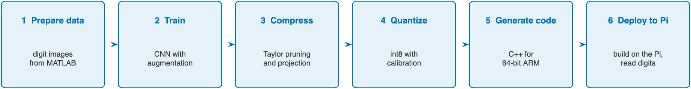{#fig-lab3-workflow width=100%}

The scripts are plain-text live scripts: open them in the MATLAB Editor to see formatted text and figures inline. Run them in order, because each script loads the MAT files saved by the previous one.

## Step 1 — Prepare the data

Run `Part1_PrepareData.m`. The data set that comes with Deep Learning Toolbox has 10,000 grayscale images of handwritten digits, 28 × 28 pixels, 1,000 for each digit. The digits are white on a black background.

```{.matlab}
dataFolder = fullfile(matlabroot,"toolbox","nnet","nndemos","nndatasets","DigitDataset");
imds = imageDatastore(dataFolder,IncludeSubfolders=true,FileExtensions=".png",LabelSource="foldernames");
[imdsTrain,imdsVal,imdsTest] = splitEachLabel(imds,0.7,0.15,"randomized");
```

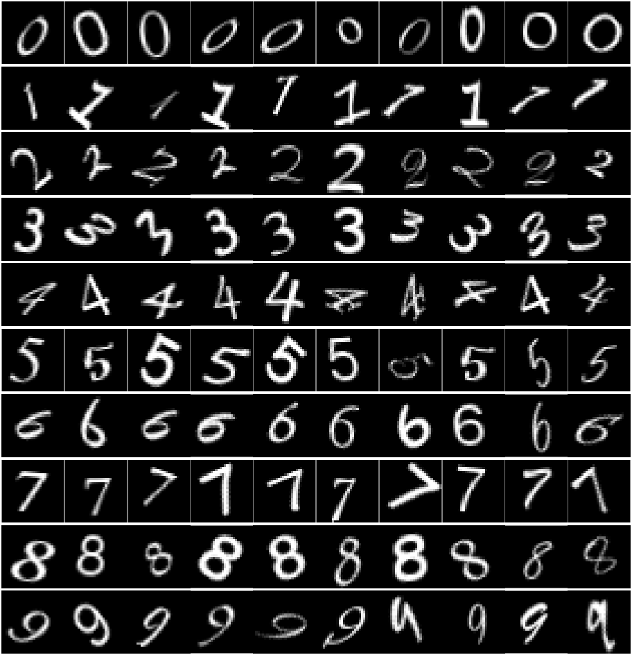{#fig-lab3-digits width=60%}

```
        Set         Images
    ____________    ______
    "Training"       7000
    "Validation"     1500
    "Test"           1500
```

The set does not say who wrote each digit, so writers can appear in more than one of the three sets, and the test accuracy is a little better than it would be for a stranger's handwriting. Step 6 measures the accuracy on your own writing.

## Step 2 — Train the network

Run `Part2_TrainNetwork.m`. The network has three convolution blocks. Each one finds simple patterns (strokes, then curves and corners), and each pooling layer halves the width and height. Global average pooling collapses the last feature maps, and a fully connected layer turns them into ten scores.

```{.matlab}
layers = [
    imageInputLayer([28 28 1],Normalization="none")
    convolution2dLayer(3,16,Padding="same")
    batchNormalizationLayer
    reluLayer
    maxPooling2dLayer(2,Stride=2)
    convolution2dLayer(3,32,Padding="same")
    batchNormalizationLayer
    reluLayer
    maxPooling2dLayer(2,Stride=2)
    convolution2dLayer(3,64,Padding="same")
    batchNormalizationLayer
    reluLayer
    globalAveragePooling2dLayer
    dropoutLayer(0.2)
    fullyConnectedLayer(10)
    softmaxLayer];
```

The helper `plotImageNetworkArchitecture` draws each layer as a box. The color shows the layer type, the height grows with the number of channels, and the output size of every layer is printed below it.

```{.matlab}
plotImageNetworkArchitecture(dlnetwork(layers),[28 28 1],"Digit-reading CNN on the 28 × 28 image");
```

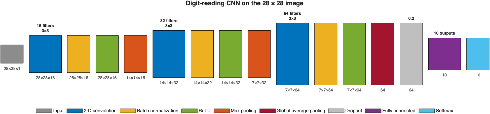{#fig-lab3-arch width=100%}

The first convolution makes 16 feature maps from the 28 × 28 image, each max pooling layer halves the width and height (28 → 14 → 7), and global average pooling collapses the last 7 × 7 × 64 maps into 64 numbers, from which the fully connected layer computes the ten scores.

A digit that you write on paper and hold in front of a camera is a little rotated, slanted, larger or smaller, and not perfectly centered. Random rotation, shearing, scaling, and shifting of the training images teach the network to cope with this.

```{.matlab}
augmenter = imageDataAugmenter(RandRotation=[-12 12],RandXShear=[-12 12], ...
    RandScale=[0.8 1.2],RandXTranslation=[-3 3],RandYTranslation=[-3 3]);
dsTrain = augmentedImageDatastore([28 28 1],XTrain,labelsTrain,DataAugmentation=augmenter);
[net,info] = trainnet(dsTrain,layers,"crossentropy",options);
```

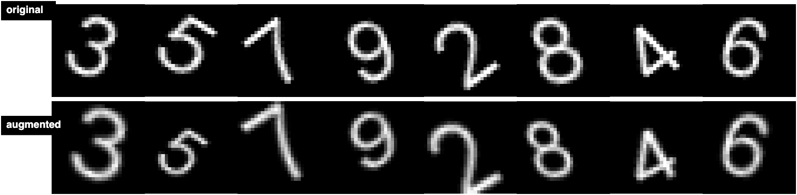{#fig-lab3-aug width=90%}

MATLAB opens the **training-progress window** while `trainnet` runs. On a laptop CPU, the 30 epochs take about a minute.

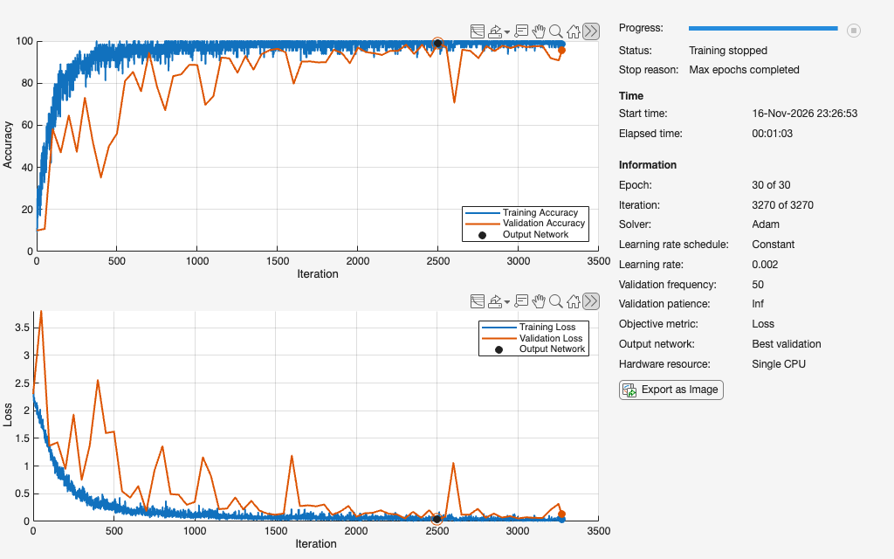{#fig-lab3-training width=95%}

```{.matlab}
accuracyTest = testnet(net,XTest,labelsTest,"accuracy")
```

```
accuracyTest = 98.9333
```

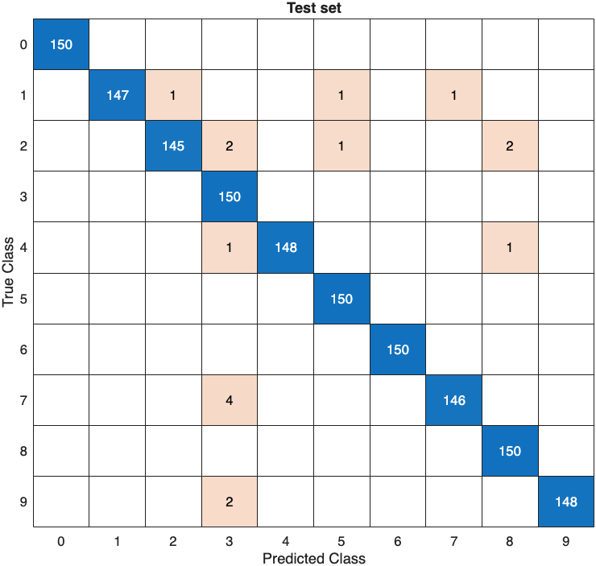{#fig-lab3-confusion width=55%}

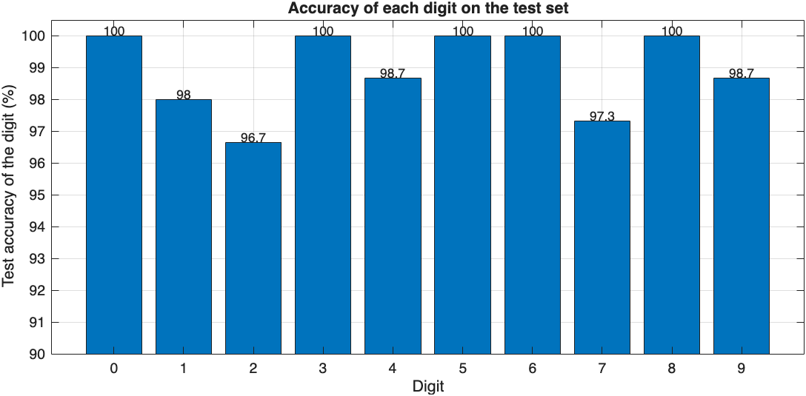{#fig-lab3-perclass width=65%}

Every digit is recognized in at least 96.7% of the test images. This number is high because the test images are written in the same styles as the training images. It is not a promise about your handwriting, your pen, and the camera.

**Grad-CAM** highlights the pixels that raised the score of the predicted class: the network looks at the strokes of the digit.

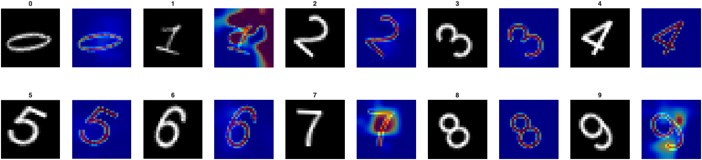{#fig-lab3-gradcam width=100%}

## Step 3 — Compress the network

### Explore how far the network can be compressed (optional)

Run `Part3a_ExploreCompression.m`. It takes a few minutes, and it shows how the recipe of this step was chosen.

#### Analyze the network

Deep Network Designer shows a report when you open the network with `deepNetworkDesigner(net)` and click **Analyze for Compression**. The helper `exportCompressionAnalysis` shows the same report in a separate window and saves it as an image.

```{.matlab}
exportCompressionAnalysis(net,fullfile(projectFolder,"images","compression-analysis.png"))
```

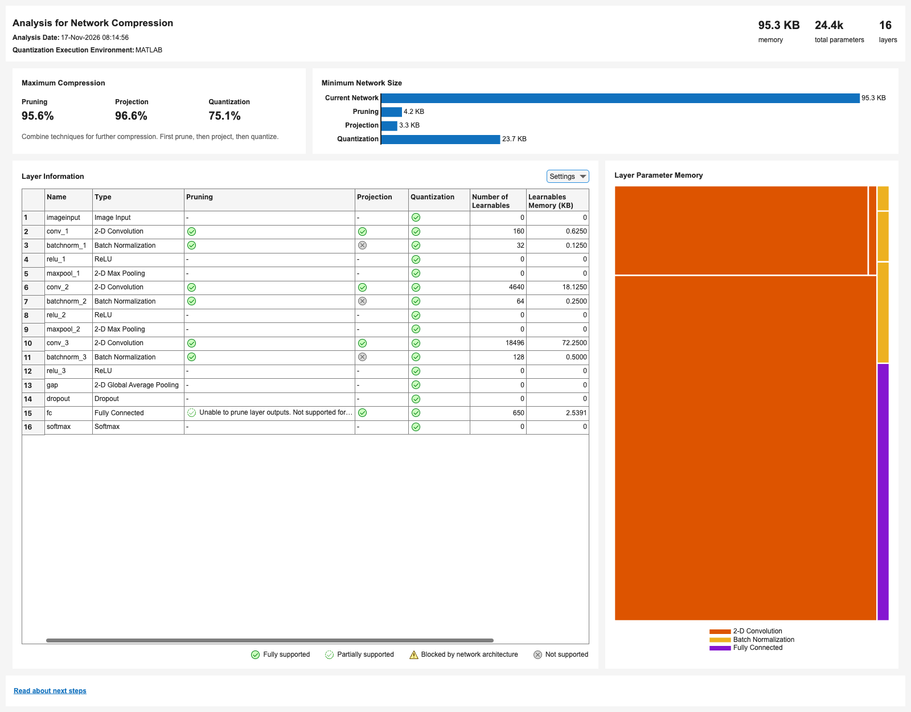{#fig-lab3-report width=100%}

The report estimates that pruning could remove up to 95.6% of the parameter memory, projection up to 96.6%, and int8 quantization 75.1%. These maximums are *structural* limits: how far each technique could go if the network structure were the only constraint, regardless of accuracy.

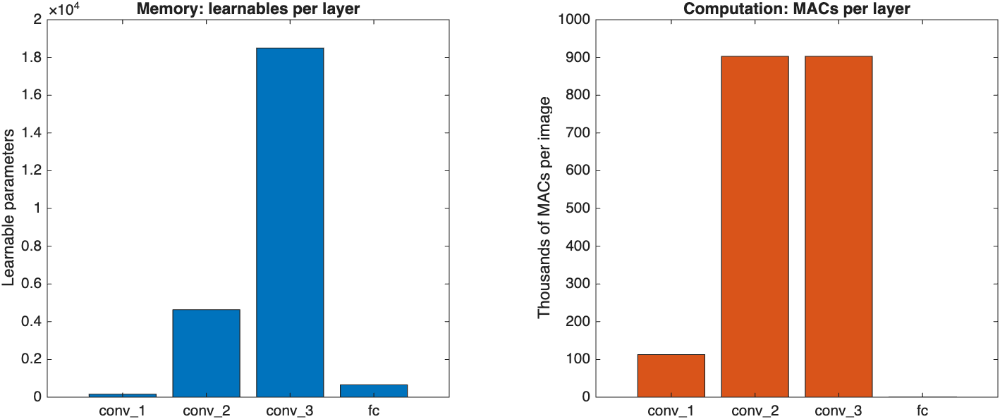{#fig-lab3-layers width=85%}

The third convolution layer holds about three quarters of the weights, and the second and third layers do nearly all of the computation, so these are the layers where compression pays off.

#### See how many directions each layer uses

Projection relies on the observation that the activations of a layer often vary along far fewer directions than the layer has neurons. `neuronPCA` computes the principal components of each layer's activations over the training data. The faster a curve rises to 100%, the more that layer can be projected without losing information.

```{.matlab}
npca = neuronPCA(net,mbqTrain);
```

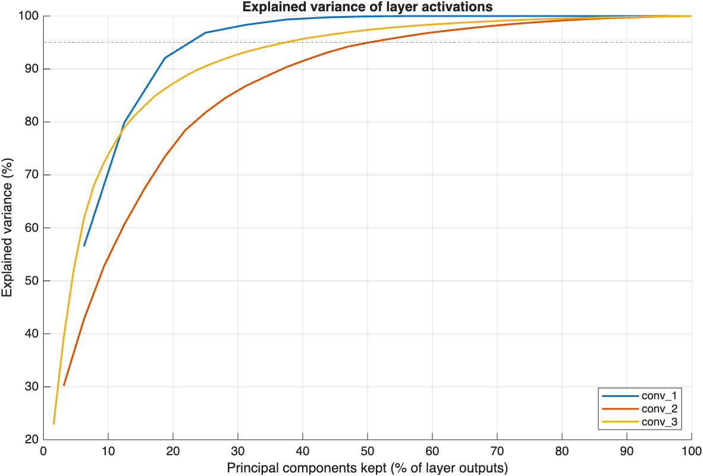{#fig-lab3-pca width=75%}

`conv_1` reaches 95% of the variance with about a fifth of its directions and `conv_3` with about a third, while `conv_2` needs about half. The network has more capacity than reading ten digits requires.

#### Measure the accuracy cost of compression

The script applies each technique at five strengths and measures the test accuracy twice: directly ("one-shot") and after 8 epochs of fine-tuning.

```{.matlab}
prunableNet = accumulateTaylorScores(net,XTrain,labelsTrain);
netPruned = dlnetwork(updatePrunables(prunableNet,MaxToPrune=numToPrune));
netProjected = compressNetworkUsingProjection(net,npca,LearnablesReductionGoal=goal);
```

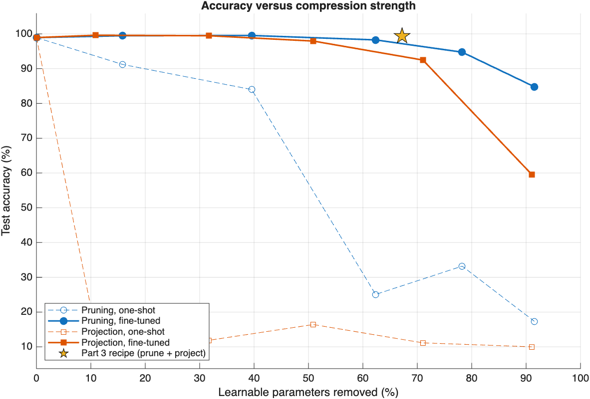{#fig-lab3-sweep width=85%}

Without fine-tuning, both techniques lose almost all of their accuracy: projection falls to 10–16% even when only 11% of the parameters are removed, and pruning keeps 91% at 16% removed and 25% at 62%. With fine-tuning, pruning keeps 98.3% up to 62% removed and 94.7% at 78%. Projection keeps 99.5% up to 32% and 97.9% at 51%, and then collapses (92.5% at 71% and 59.5% at 91%). Projection breaks down earlier because it approximates every layer at once, while pruning removes whole filters but keeps the remaining ones intact.

### Prune and project the network

Run `Part3_CompressNetwork.m`. **Taylor pruning** removes the convolution filters that matter least, and **projection** replaces each layer with two smaller layers that keep its principal directions. Each step is followed by fine-tuning with the same augmentation.

```{.matlab}
[netPruned,infoPruned] = compressNetworkUsingTaylorPruning(net,XTrain,labelsTrain,"crossentropy",optionsPruning, ...
    LearnablesReductionGoal=0.5,LearnablesReductionIncrement=0.05);
netPruned = trainnet(dsTrain,netPruned,"crossentropy",optionsFineTune);

[netProjected,infoProjected] = compressNetworkUsingProjection(netPruned,XTrain,LearnablesReductionGoal=0.3);
netProjected = trainnet(dsTrain,netProjected,"crossentropy",optionsFineTune);
```

```
          Stage           Learnables    Memory (KB)    Test accuracy (%)
    __________________    __________    ___________    _________________
    Original                23946         93.539            98.93
    Pruned                  11513         44.973            99.67
    Pruned + projected       7864         30.719            99.33
```

Projection with a goal of 50% reduced the accuracy to 96.8% in a first try, so this lab removes a gentler 30%. Fine-tuning is also extra training, so a compressed network can score as well as the original, or even a little better.

## Step 4 — Quantize the network

Run `Part4_QuantizeNetwork.m`. Quantization stores the weights and activations as 8-bit integers, which reduces the parameter memory by about a factor of four. A calibration step runs training images through the network to find the range of values in every layer.

```{.matlab}
quantObj = dlquantizer(netCompressed,ExecutionEnvironment="MATLAB");
prepareNetwork(quantObj);
calibrate(quantObj,augmentedImageDatastore([28 28 1],XTrain(:,:,:,1:3:end)));
netQ = quantize(quantObj,ExponentScheme="histogram");
```

```
                    Stage                    Learnables    Parameter memory (KB)    Test accuracy (%)
    Original (float32)                          23946              93.54                   98.93
    Pruned + projected (float32)                 7864              30.72                   99.33
    Pruned + projected + quantized (int8)        7681               7.93                   97.80
```

The int8 network gives the same answer as the float network for 98.2% of the test images.

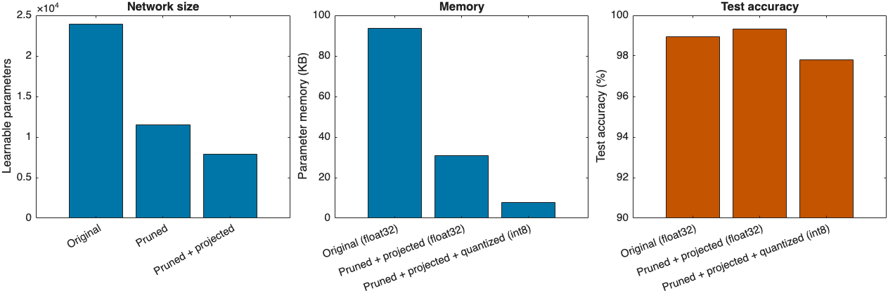{#fig-lab3-compression width=100%}

Run `Part3a_ExploreCompression.m` again to place this result in the full design space: every option from the sweep at float32 and at the estimated int8 size, and the path taken through Steps 3 and 4.

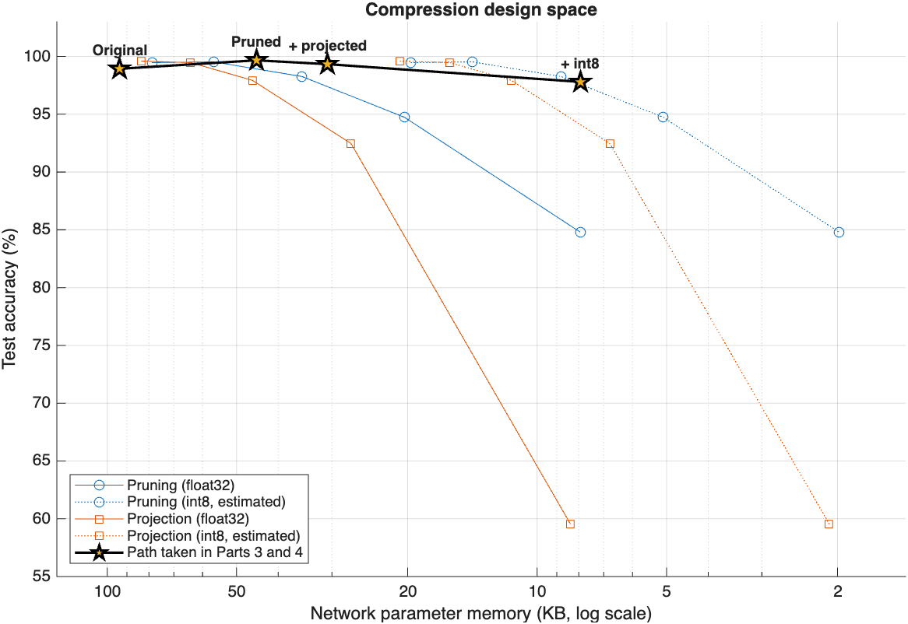{#fig-lab3-design-space width=85%}

Moving to the right means a smaller network. The path of this lab stays near the top of the chart: the int8 network needs 7.9 KB, the same as the float network that was pruned by 91% in the sweep, but it keeps 97.8% accuracy instead of 84.8%.

## Step 5 — Generate C++ code

Run `Part5_GenerateCode.m`. Code generation starts from the entry-point function `digitDetect`. It takes a 480 × 640 camera frame, prepares it with `preprocessFrame`, runs the quantized network, and returns the digit and the ten probabilities. If nothing is written in the middle of the frame, it returns −1: "no digit".

```{.matlab}
function [digit,probabilities] = digitDetect(frame) %#codegen
persistent net
if isempty(net)
    net = coder.loadDeepLearningNetwork("models/netQ.mat");
end
x = preprocessFrame(frame);                                  % 28 x 28, ink = 1, paper = 0
if ~any(x(:))                                                % blank paper
    digit = int32(-1);
    probabilities = zeros(10,1,"single");
    return
end
probabilities = extractdata(predict(net,dlarray(x,"SSCB")));
[~,k] = max(probabilities);
digit = int32(k - 1);
end
```

The input is labeled `"SSCB"` (spatial, spatial, channel, batch): code generation for quantized pooling layers requires the batch dimension, even for a single image.

### Prepare the camera frame

The camera sees dark ink on white paper, but the network was trained on white digits on a black background, and on digits that are centered. `preprocessFrame` bridges the difference in four steps:

1. It keeps the centered 448 × 448 square of the frame, and averages 16 × 16 blocks of pixels to get 28 × 28.
2. It estimates the paper with a **morphological closing** (a maximum filter followed by a minimum filter over 7 × 7 pixels). The closing removes the thin dark strokes of the ink but keeps a smooth change of the light across the paper, so a shadow or a gradient is not mistaken for ink.
3. The paper becomes 0 and the ink becomes values up to 1. If there is hardly any ink, the result is empty and the function reports "no digit".
4. It moves the center of mass of the ink to the center of the image. \

It uses only basic array operations, so MATLAB and the Pi prepare the images in exactly the same way.

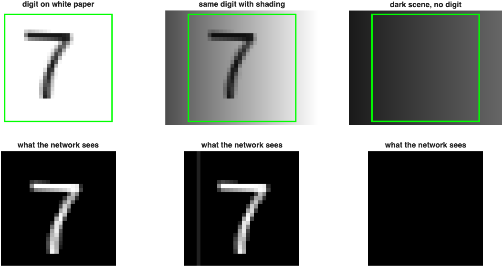{#fig-lab3-preprocessing width=90%}

To test the complete function on all 1,500 test digits, each digit is enlarged 16 times, drawn as dark ink on white paper, and placed in the center of a 480 × 640 frame. A MEX function with the same deep learning settings is compared with MATLAB:

```{.matlab}
mexCfg = coder.config("mex");
mexCfg.DeepLearningConfig = coder.DeepLearningConfig(TargetLibrary="none");
mexCfg.LargeConstantGeneration = "KeepInSourceFiles";
codegen -config mexCfg digitDetect -args {zeros(480,640,3,"uint8")} -o digitDetect_mex
```

```
accuracyFunction = 95.9333      % the whole function on the test frames
digitBlank = -1                  % a blank sheet gives "no digit"
digitAgreement = 1               % the MEX function gives the same digit for every frame
maxDifference = 0                % and the same probabilities
```

The whole function scores 95.9%, a little less than the network alone: turning a digit into a photograph and back changes a few pixels. Then the script generates the C++ library for a 64-bit ARM processor:

```{.matlab}
cfg = coder.config("lib");
cfg.TargetLang = "C++";
cfg.GenCodeOnly = true;
cfg.DeepLearningConfig = coder.DeepLearningConfig(TargetLibrary="none");
cfg.LargeConstantGeneration = "KeepInSourceFiles";
cfg.HardwareImplementation.ProdHWDeviceType = "ARM Compatible->ARM 64-bit (LP64)";
codegen -config cfg digitDetect -args {zeros(480,640,3,"uint8")} -d codegen/lib -report
```

- `TargetLibrary="none"` generates plain C++ code with no dependency on third-party libraries.
- `LargeConstantGeneration="KeepInSourceFiles"` embeds the network weights in the C++ source files, so the program does not depend on separate data files.

## Step 6 — Deploy to the Raspberry Pi and read digits

### Connect to the board

Run `Part6_DeployToRaspberryPi.m`. Define the connection details in the Command Window, so that your password is never saved in a script, and connect with `raspi`.

```{.matlab}
piAddress = "raspberrypi.local";
piUser = "pi";
piPassword = "...";            % type your password in the Command Window only
r = raspi(piAddress,piUser,piPassword)
```

### Prepare the paper and the camera view

Write a digit in the middle of a white sheet with a **thick black marker or a thick dark pen**, as large as the green square allows. The network sees only the centered square of the camera frame. Thin pencil strokes, a small digit, or a sheet that is moved make the result worse. Light the paper evenly and hold it still.

```{.matlab}
cam = cameraboard(r,"Resolution","640x480");
frame = snapshot(cam);
imshow(frame)
rectangle(Position=[97 17 448 448],EdgeColor="g",LineWidth=3)
imshow(preprocessFrame(frame))      % what the network sees
```

### Measure your accuracy

The test set of Step 2 contains digits written like the training digits. Your handwriting, your pen, and the camera are different. This section of `Part6_DeployToRaspberryPi.m` measures how well the network reads *your* digits: for each digit from 0 to 9, it counts you down for 8 seconds, so that you can put the next sheet in the green square, and takes five pictures. The pictures are read with the MEX function from Step 5, and the section prints the accuracy and draws a confusion chart.

::: {.callout-warning title="No accuracy on a camera is given here"}
The accuracy on a camera depends on your pen, your handwriting, the paper, and the light, and the reference run of this lab did not measure it. Measure it yourself with this section before you rely on the program. Frames from a camera can differ from the training images in ways that the preparation of the frame cannot fully remove.
:::

### Build the program on the Pi

`digitReaderApp` is the program for the Pi. It creates the camera, then grabs frame after frame and calls `digitDetect` on each, until it is stopped.

```{.matlab}
function digitReaderApp() %#codegen
r = raspi;
cam = cameraboard(r,"Resolution","640x480");
k = int32(0);
while true
    k = k + 1;
    frame = snapshot(cam);
    t0 = tic;
    [digit,probabilities] = digitDetect(frame);
    ms = toc(t0)*1000;
    if digit < 0
        fprintf("frame %2d: no digit  (%5.1f ms)\n",k,ms);
    else
        fprintf("frame %2d: digit %d  (confidence %3.0f%%, %5.1f ms)\n",k,digit,100*max(probabilities),ms);
    end
    pause(0.1);                    % about 10 frames per second, and no busy loop
end
end
```

Configure code generation for a stand-alone program on a 64-bit Raspberry Pi. MATLAB generates the C++ code on your computer, copies it to the Pi, and builds it there with the compiler on the Pi. The board type must match the operating system: `Raspberry Pi (64bit)` for a 64-bit system, and `Raspberry Pi` for a 32-bit system. MATLAB warns that the program does not end: that is intended.

```{.matlab}
hw = coder.hardware("Raspberry Pi (64bit)");
hw.DeviceAddress = r.DeviceAddress;  hw.Username = piUser;  hw.Password = piPassword;
hw.BuildDir = "/home/" + piUser + "/MATLAB_ws/digitreader";
cfg = coder.config("exe");
cfg.Hardware = hw;
cfg.GenerateExampleMain = "GenerateCodeAndCompile";
cfg.DeepLearningConfig = coder.DeepLearningConfig(TargetLibrary="none");
cfg.LargeConstantGeneration = "KeepInSourceFiles";
codegen -config cfg digitReaderApp -d codegen/pi -report
```

### Run it on the camera

Start the program on the board for 20 seconds, show a digit to the camera, and change it every few seconds. The `timeout -s KILL 20` command stops the program after 20 seconds, and `stdbuf -oL` sends each line as soon as it is printed.

```{.matlab}
program = strtrim(string(system(r,"find /home/" + piUser + "/MATLAB_ws/digitreader -name digitReaderApp.elf | head -1")));
output = system(r,"cd '" + fileparts(program) + "' && stdbuf -oL timeout -s KILL 20 ./digitReaderApp.elf 2>/dev/null; true");
system(r,"pkill -9 -f '[d]igitReaderApp.elf'; true");     % make sure that no copy of the program keeps running
disp(output)
```

```
frame  1: no digit  (  0.8 ms)
frame  2: no digit  (  0.7 ms)
frame  3: no digit  (  0.7 ms)
...
```

These lines are from a run in a dark scene without a digit. When a digit is in the square, a line has the form `frame 12: digit 7  (confidence  97%,   3.1 ms)`, with the digit, the confidence, and the time. With a digit, the preparation of the frame and the network take about 3 ms on the Pi 5, so the loop is limited by the camera and the pause, at about 10 frames per second.

To use it live without a time limit, open a terminal on your computer, log in to the Pi with `ssh`, go to the program folder, and start `./digitReaderApp.elf 2>/dev/null`. Each line appears while the program runs, and Ctrl+C stops it. The program is 163 KB, and it uses about 28 MB of memory while it runs, including the camera libraries.

::: {.callout-warning title="Things that make it worse"}
A thin or light pen, a digit that does not fill the green square, a sheet that moves, strong shadows across the paper, and other dark marks in the square (a fold, a printed line, the edge of the sheet) can all be read as strokes of a digit. Digits that look alike (1 and 7, 4 and 9, 3 and 5) are the most likely to be confused. Blank paper gives "no digit".
:::

## Results summary

| Quantity | Reference result |
|---|---|
| Test accuracy, float network (1,500 images of the data set) | 98.9% |
| Test accuracy, pruned and projected / int8 | 99.3% / 97.8% |
| Parameter memory | 93.5 KB → 7.9 KB (−92%) |
| Whole function on test images placed in camera frames | 95.9% |
| MATLAB versus generated code (MEX) | identical digits and probabilities |
| Program size on the Pi | 163 KB |
| Peak memory of the program on the Pi | about 28 MB |
| Time per frame on the Pi (preparation and network) | about 3 ms |
| Accuracy on a camera, with your handwriting | not measured here: use "Measure your accuracy" |

## Extension challenge

Measure your accuracy with the last section of Part 6, and look at the confusion chart: find out whether the pen, the light, or the size of the digit is the problem. Then record your own digits with the Pi camera, add them to the training data in Part 1, and train again. Compare the accuracy on your own handwriting before and after.

## Where to go next

- **More training data:** train on the 70,000 images of the MNIST data set, which has many more writers.
- **Digits in a row:** read a number with several digits by splitting the frame into cells.
- **Transfer learning:** start from a pretrained network (a support package in the Add-On Explorer) for a harder task, such as letters.
