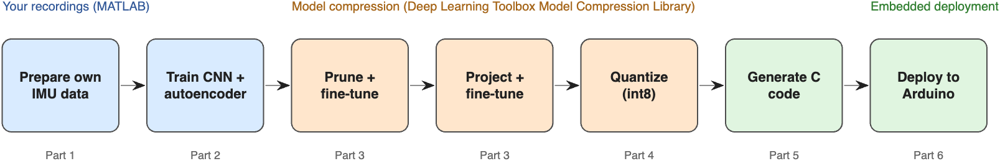
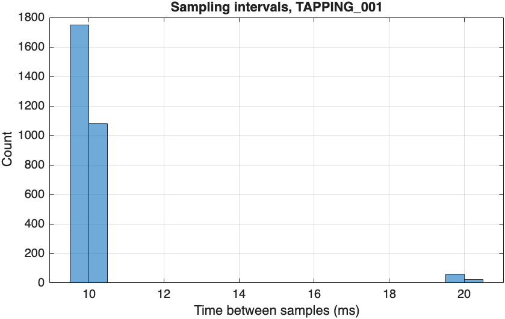
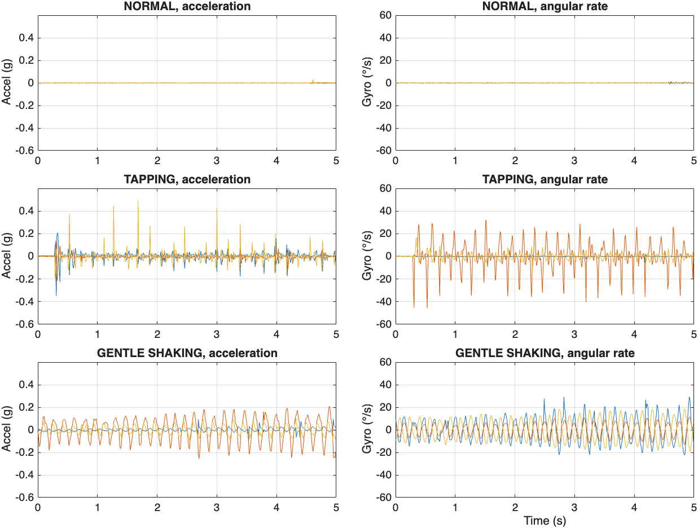
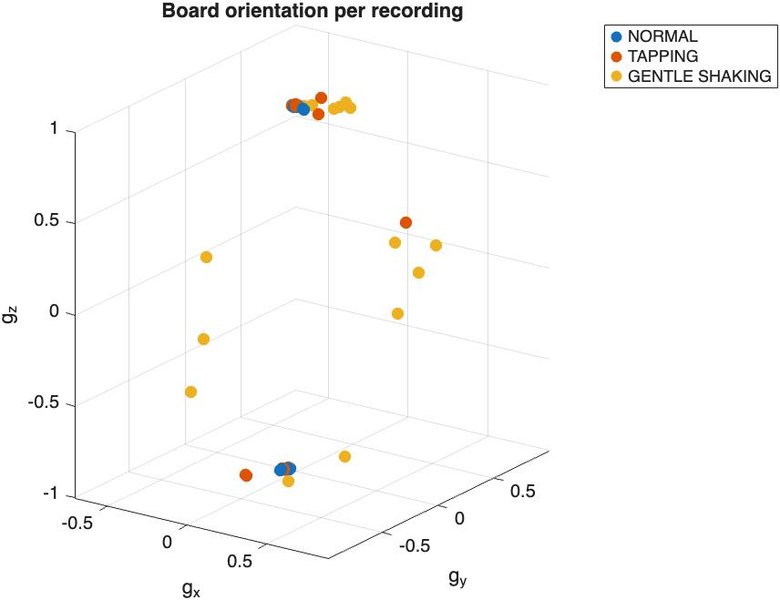
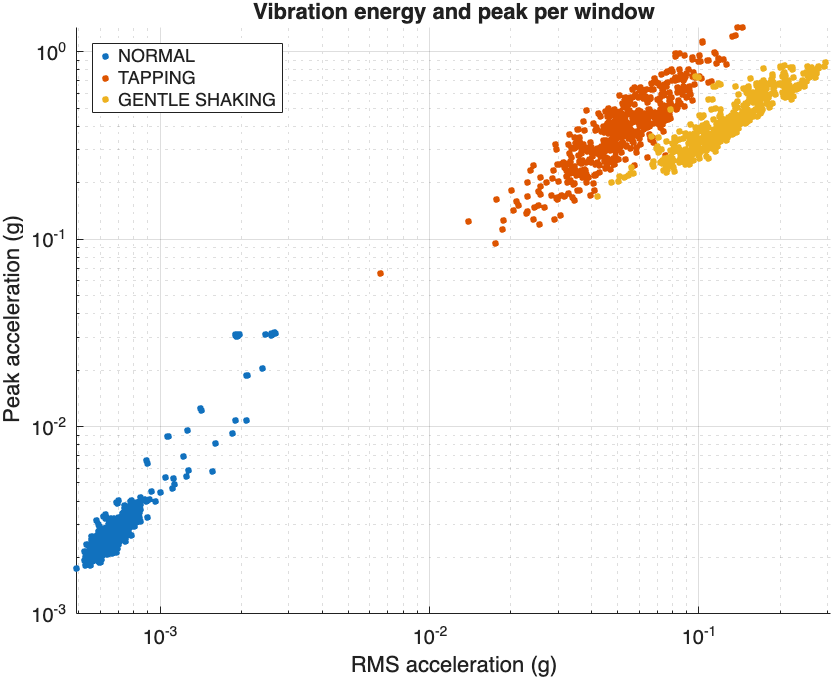
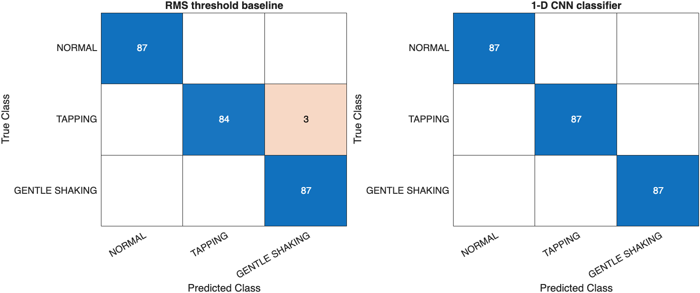
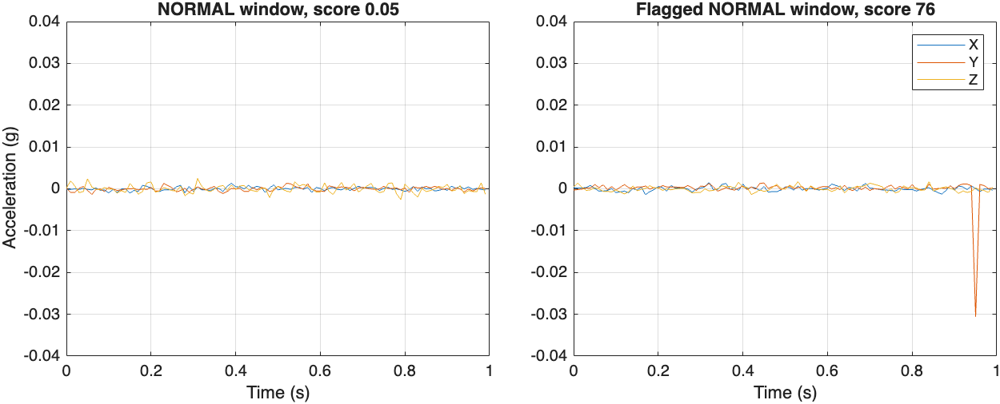
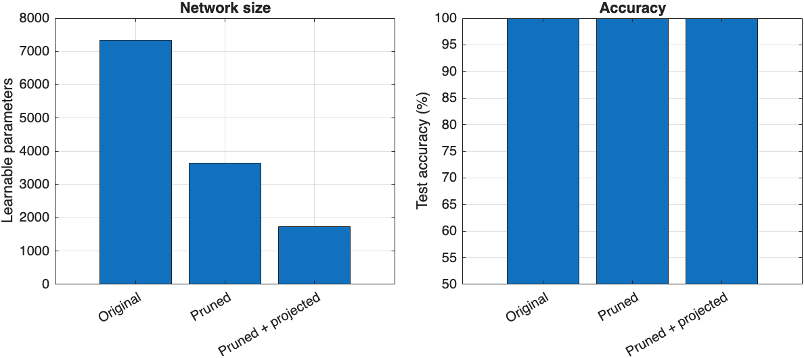
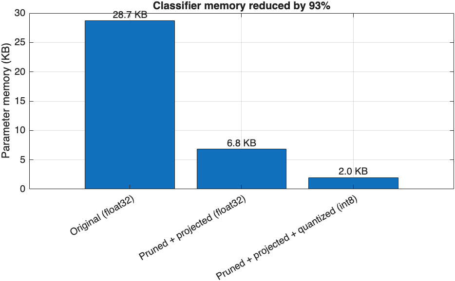
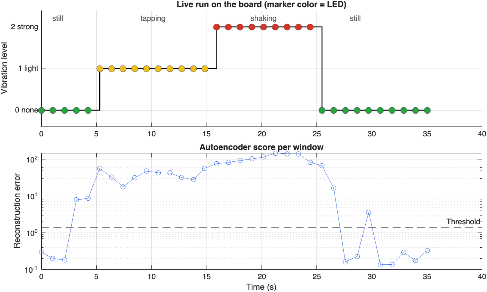

# Build a Vibration Severity Monitor from Your Own IMU Recordings on Arduino Nano 33 BLE Sense

This example shows how to train, compress, and deploy a vibration severity monitor using data recorded with the same Arduino® Nano 33 BLE Sense that runs the model. Every second, the board reports whether it is still, vibrating lightly, or vibrating strongly, and flags vibration it does not recognize.

In the [first tutorial](../01-vibration-anomaly-detection/README.md), the detector was trained on a public ceiling-fan dataset. On the board it reported every window as unknown, because the board and its surroundings looked nothing like the training data. This *domain shift* is the most common reason embedded AI models fail in the field. This example removes it by training on 45 recordings made with the board's own LSM9DS1 IMU. The deployed model reads exactly the sensor and settings it was trained on.

The board reports three vibration levels, similar to the severity zones used in machine-condition monitoring:

| Level | Recorded as | Character | LED |
|---|---|---|---|
| 0, no vibration | `NORMAL` | board at rest, sensor noise only (about 0.001 g RMS) | green |
| 1, light vibration | `TAPPING` | short impulsive bursts (about 0.05 g RMS) | yellow |
| 2, strong vibration | `GENTLE_SHAKING` | sustained large motion (about 0.13 g RMS) | red |
| unrecognized | — | the classifier reports level 0 but the autoencoder disagrees for 3 s | blue |

As in the first tutorial, the detector is a hybrid of a **1-D CNN classifier** and an **autoencoder trained only on NORMAL data**. It is compressed with pruning, projection, and quantization, then deployed as generated C code. The int8 classifier needs 2.0 KB of parameter memory (a 93% reduction), classifies all held-out test windows correctly, and runs in 65 ms per one-second window on the board.



The example consists of these steps:

1. **Prepare Data**: inspect the logger's timing, resample to a uniform 100 Hz grid, handle board orientation, and split by recording (`Part1_PrepareData.m`).
2. **Train Networks**: compare against an RMS-threshold baseline, train the classifier and the autoencoder, and examine what the autoencoder finds (`Part2_TrainNetworks.m`).
3. **Compress Classifier**: Taylor pruning and projection, each followed by fine-tuning (`Part3_CompressClassifier.m`).
4. **Quantize Networks**: convert both networks to 8-bit integers (`Part4_QuantizeNetworks.m`).
5. **Generate Code**: generate C code for the Arm® Cortex®-M4 and verify it against MATLAB (`Part5_GenerateCode.m`).
6. **Deploy to Arduino**: build, flash, and test the monitor live (`Part6_DeployToArduino.m`).

**Products required:** Deep Learning Toolbox™, Deep Learning Toolbox Model Compression Library, MATLAB Coder™, MATLAB Coder Interface for Deep Learning, Embedded Coder®, Fixed-Point Designer™, and Statistics and Machine Learning Toolbox™. Signal Processing Toolbox is not required.
**Hardware required:** Arduino Nano 33 BLE Sense Rev1 (LSM9DS1 IMU) and Arduino IDE 2 with the *Arduino Mbed OS Nano Boards* core and the *Arduino_LSM9DS1* library.

---

## Step 1: Prepare Data

### About the Recordings

The data was logged from the board's LSM9DS1 IMU with the Arduino_LSM9DS1 library at a nominal 100 Hz. There are 15 recordings of 30 seconds for each class, one folder per class. Each row holds a microsecond timestamp, the acceleration in g, the angular rate in degrees per second, and the label.

```matlab
head(readtable(fullfile(dataFolder,"NORMAL","NORMAL_001.csv")),4)
```

```
    timestamp_us       ax           ay         az         gx         gy        gz        label
    ____________    _________    ________    _______    _______    ______    ______    __________
     1.1793e+08     -0.009888     0.01416    0.99499    0.67139    7.6904    1.5259    {'NORMAL'}
     1.1794e+08     -0.009399    0.014771    0.99524    0.79346    7.3853    1.5259    {'NORMAL'}
```

### Check the Sampling

A real logger is never perfectly regular. Most sample intervals are 10 ms, but about 80 per recording are 20 ms, because the logger occasionally missed a sample.



The networks need evenly spaced samples, so `loadRecordings` uses the timestamps to interpolate each recording onto a uniform 100 Hz grid.

```matlab
recordings = loadRecordings(dataFolder,100);
```

```
        Class         GroupCount    mean_Duration    sum_MissedSamples
    ______________    __________    _____________    _________________
    NORMAL                15           29.937              1192
    TAPPING               15           29.941              1169
    GENTLE_SHAKING        15           29.935              1181
```

### Look at the Signals

Tapping produces short spikes, and shaking produces large, continuous motion on both sensors. The mean of each channel is removed so that gravity and the gyroscope bias do not hide the motion.



### Check the Board Orientation

The mean acceleration of a recording is the gravity vector, which shows how the board was oriented. The `NORMAL` recordings were made face up and face down, while the shaking recordings cover many angles.



A network that saw the raw signal could learn the shortcut "tilted board means shaking", which would fail as soon as the board is mounted differently. Every feature in this example removes the mean of each window first, so the orientation cannot be used.

### Split the Data by Recording

Use 9 recordings per class for training, 3 for validation, and 3 for testing. Windows from the same 30 s recording share orientation and handling, so splitting whole recordings, rather than windows, keeps the test honest.

```matlab
recordingSplit = splitRecordings(recordings.Class,[9 3 3]);
```

Cut the recordings into one-second windows of 100 samples by 6 channels. Training windows overlap by 50%; validation and test windows do not overlap.

```
numWindows =
        1566         261         261
```

### Vibration Energy per Class



The classes are ordered by energy, but the tapping and shaking clusters touch, and at the same energy a tap has a higher peak than a shake. A single peak threshold would get the order wrong. A few `NORMAL` windows also reach about 0.03 g: they are examined in Step 2.

---

## Step 2: Train Networks

### Start with a Baseline

Before training a network, check what a simple rule achieves. A decision tree with two splits on the log RMS acceleration amounts to choosing two thresholds.

```matlab
baseline = fitctree(log10(rmsOf(windowsTrain)),labelsTrain,MaxNumSplits=2);
accuracyBaseline = 100*mean(predict(baseline,log10(rmsOf(windowsTest))) == labelsTest)
```

```
accuracyBaseline = 98.8506
```

Vibration energy alone separates most windows. Its three mistakes are vigorous taps classified as shaking: telling them apart needs the shape of the signal, an isolated impulse versus continuous motion.

### Train the 1-D CNN Classifier

The classifier reads the mean-removed raw window, 100 time steps by 6 channels, scaled per channel. The architecture matches the first tutorial; global average pooling makes the prediction independent of where in the window a tap occurs.

```matlab
layersCls = [
    sequenceInputLayer(6,MinLength=100)
    convolution1dLayer(5,16,Padding="same")
    batchNormalizationLayer
    reluLayer
    maxPooling1dLayer(2,Stride=2)
    convolution1dLayer(5,32,Padding="same")
    batchNormalizationLayer
    reluLayer
    maxPooling1dLayer(2,Stride=2)
    convolution1dLayer(3,32,Padding="same")
    batchNormalizationLayer
    reluLayer
    globalAveragePooling1dLayer
    fullyConnectedLayer(32)
    reluLayer
    fullyConnectedLayer(3)
    softmaxLayer];
netCls = trainnet(XTrain,labelsTrain,layersCls,"crossentropy",optionsCls);
accuracyCls = testnet(netCls,XTest,labelsTest,"accuracy",InputDataFormats="TCB")
```

```
accuracyCls = 100
```



The CNN also classifies the three boundary windows that the threshold got wrong. With only three test recordings per class, treat the exact percentage with care: it shows that the classes are well separated in new sessions, not that the model never makes a mistake.

### Train the Autoencoder on NORMAL Windows

The autoencoder learns 24 motion indicators of an undisturbed board (log RMS, crest factor, kurtosis, and high-frequency energy fraction per channel) and reconstructs them through a 6-neuron bottleneck.

```matlab
layersAE = [
    featureInputLayer(24)
    fullyConnectedLayer(32)
    reluLayer
    fullyConnectedLayer(6)
    reluLayer
    fullyConnectedLayer(32)
    reluLayer
    fullyConnectedLayer(24)];
netAE = trainnet(ZTrain,ZTrain,layersAE,"mse",optionsAE);
```

### Choose a Robust Anomaly Threshold

Most `NORMAL` validation windows have a tiny reconstruction error, but a few are very large:

```
prctile(scoreValNormal,[50 90 95 99]) =   0.1713    0.3543    2.5082   72.2752
```

A 99th-percentile threshold would be pulled up by these few windows. Instead, use the median plus five scaled median absolute deviations of the log score, which ignores a handful of outliers.

```matlab
logScore = log10(scoreValNormal);
aeThreshold = 10^(median(logScore) + 5*1.4826*mad(logScore,1))
```

```
aeThreshold = 1.5197
```

### Find What the Autoencoder Found

```
        Class         GroupCount    mean_Flagged
    ______________    __________    ____________
    NORMAL                87          0.091954
    TAPPING               87                 1
    GENTLE_SHAKING        87                 1
```

The autoencoder flags every tapping and shaking window, and also 8 windows inside `NORMAL` recordings.



```
    NORMAL test windows    Count    Median peak (g)
    ___________________    _____    _______________
       "Not flagged"         79         0.0021334
       "Flagged"              8          0.030437
```

The flagged windows contain small real bumps, such as someone touching the table during a `NORMAL` recording. The labels describe a whole 30 s recording, but the autoencoder judges each second on its own and notices them. The classifier, trained on recording labels, calls these windows level 0; the autoencoder reports them as unrecognized vibration. This is what the hybrid design adds.

---

## Step 3: Compress Classifier

Prune first, then project, and fine-tune after each step.

```matlab
[netPruned,infoPruned] = compressNetworkUsingTaylorPruning(netCls,XTrain,TTrain,"crossentropy",optionsPruning, ...
    LearnablesReductionGoal=0.5, ...
    LearnablesReductionIncrement=0.05);
```

```
Compressed network has 50.1% fewer learnable parameters.
Pruning compressed 5 layers: "conv1d_2","batchnorm_2","conv1d_3","batchnorm_3","fc_1"
```

```matlab
[netProjected,infoProjected] = compressNetworkUsingProjection(netPruned,XTrain, ...
    InputDataFormats="TCB", ...
    LearnablesReductionGoal=0.5);
```

```
Compressed network has 50.2% fewer learnable parameters.
Projection compressed 4 layers: "conv1d_2","conv1d_3","fc_1","fc_2"
```

```
          Stage           Learnables    Memory (KB)    Test accuracy (%)
    __________________    __________    ___________    _________________
    Original                 7347         28.699              100
    Pruned                   3636         14.203              100
    Pruned + projected       1745         6.8164              100
```



Because the classes are well separated, the network keeps its accuracy after a 76% reduction in learnables.

---

## Step 4: Quantize Networks

```matlab
quantObjCls = dlquantizer(netClsCompressed,ExecutionEnvironment="MATLAB");
prepareNetwork(quantObjCls);
calibrate(quantObjCls,arrayDatastore(XTrain(1:3:end),OutputType="same"));
netClsQ = quantize(quantObjCls,ExponentScheme="histogram");
```

Quantize the autoencoder the same way and recompute the robust threshold with the quantized network (`aeThreshold = 1.4048`). The quantized autoencoder flags the same windows.

```
                    Stage                    Learnables    Parameter memory (KB)    Test accuracy (%)
    _____________________________________    __________    _____________________    _________________
    Original (float32)                          7347              28.699                   100
    Pruned + projected (float32)                1745              6.8164                   100
    Pruned + projected + quantized (int8)       1705              1.9697                   100
```



---

## Step 5: Generate Code

The entry-point function `vibrationSeverityDetect` takes one 100-by-6 window and returns the level, the three class probabilities, the autoencoder score, and the unrecognized flag.

```matlab
function [level,probabilities,aeScore,isUnrecognized] = vibrationSeverityDetect(window) %#codegen
persistent netCls netAE
if isempty(netCls)
    netCls = coder.loadDeepLearningNetwork("models/netClsQ.mat");
    netAE = coder.loadDeepLearningNetwork("models/netAEQ.mat");
end
params = coder.load("models/deploymentParams.mat");

x = (single(window) - mean(single(window),1)) ./ params.channelScale;
probabilities = extractdata(predict(netCls,dlarray(reshape(x',6,1,100),"CBT")));
[~,k] = max(probabilities);
level = int32(k - 1);

ci = (computeMotionIndicators(window) - params.ciMu) ./ params.ciSigma;
ciHat = extractdata(predict(netAE,dlarray(ci',"CB")));
aeScore = mean((ciHat - ci').^2);

isUnrecognized = level == 0 && aeScore > params.aeThreshold;
end
```

The code generation settings are the same as in the first tutorial: `TargetLibrary="none"`, `LargeConstantGeneration="KeepInSourceFiles"`, no dynamic memory, and the `ARM Cortex-M` device type. Verify the generated code with a MEX function on all 261 test windows:

```
levelAgreement = 1
medianRelativeDifferenceScore = 1.4674e-07
flagAgreement = 1
```

```c
extern void vibrationSeverityDetect(const float window[600], int *level,
                                    float probabilities[3], float *aeScore,
                                    bool *isUnrecognized);
```

---

## Step 6: Deploy to Arduino

The sketch `arduino/VibrationSeverityMonitor/VibrationSeverityMonitor.ino` keeps the Arduino_LSM9DS1 library's default settings (119 Hz output data rate, ±4 g, ±2000 °/s), which match the recordings, and samples acceleration and angular rate every 10 ms. It shows blue only after **3 consecutive** unrecognized windows, so a single small bump, such as a knock on the desk or a touch on the USB cable, does not make the LED flicker. Change `kUnrecognizedWindows` to adjust this.

```c
unrecognizedCount = isUnrecognized ? unrecognizedCount + 1 : 0;
int state = (unrecognizedCount >= kUnrecognizedWindows) ? 3 : level;
```

```
Sketch uses 112256 bytes (11%) of program storage space. Maximum is 983040 bytes.
Global variables use 48344 bytes (18%) of dynamic memory, leaving 213800 bytes for local variables. Maximum is 262144 bytes.
```

### Test the Monitor Live

With the board flashed, the board was left still, then tapped, then shaken gently, then left still again, while MATLAB read the serial output.



| Phase | Windows | Board output |
|---|---|---|
| Still | 5 | level 0, green |
| Tapping | 10 | level 1, yellow |
| Shaking | 9 | level 2, red |
| Still | 10 | level 0, green |

The classifier tracked every phase, with a confidence of 0.98–0.996 on all windows except the one where tapping started partway through (0.65). The autoencoder score rose above the threshold in five windows where the classifier reported level 0: two as a hand approached the board, two while the board settled after shaking, and one small bump. None lasted three windows, so the LED stayed green. Inference takes 65 ms per window on the 64 MHz Cortex-M4F.

---

## Next Steps

- Add a level by recording 15 sessions of a new condition, for example a fan or phone vibrating under the board, and adding a class in Step 2.
- Reduce the delay by sampling into a second buffer while the detector runs, so that windows can overlap.
- Report the level over Bluetooth Low Energy with the ArduinoBLE library.

## Supporting Files

| File | Description |
|---|---|
| `helpers/loadRecordings.m` | Load the CSV recordings and resample them onto a uniform grid |
| `helpers/makeWindows.m` | Cut recordings into fixed-length windows, keeping the recording index |
| `helpers/splitRecordings.m` | Stratified train/validation/test split by recording |
| `helpers/computeMotionIndicators.m` | 24 motion indicators per window (supports code generation) |
| `helpers/autoencoderScore.m` | Mean squared reconstruction error |
| `helpers/networkSummary.m` | Learnables and parameter memory of a network |
| `codegen/vibrationSeverityDetect.m` | Entry-point function for code generation |
| `arduino/VibrationSeverityMonitor/` | Arduino sketch; the generated C code is copied to `src/model/` |
| `data/raw/Vibration_Dataset/` | The 45 recordings (NORMAL, TAPPING, GENTLE_SHAKING) |

## See Also

`interp1` | `fitctree` | `trainnet` | `testnet` | `compressNetworkUsingTaylorPruning` | `compressNetworkUsingProjection` | `dlquantizer` | `estimateNetworkMetrics` | `mad` | `codegen` | `coder.loadDeepLearningNetwork` | `serialport`

## Related Examples

- [Tutorial 1: Train, Compress, and Deploy a Vibration Anomaly Detector](../01-vibration-anomaly-detection/README.md)
- [Train and Compress AI Model for Road Damage Detection](https://www.mathworks.com/help/deeplearning/ug/train-and-compress-ai-model-for-road-damage-detection.html)
- [Analyze and Compress 1-D Convolutional Neural Network](https://www.mathworks.com/help/deeplearning/ug/analyze-and-compress-1d-convolutional-neural-network.html)
- [Generate Generic C/C++ Code for Deep Learning Networks](https://www.mathworks.com/help/coder/ug/generate-generic-cc-code-for-deep-learning-networks.html)
- [Out-of-Distribution Detection for Deep Neural Networks](https://www.mathworks.com/help/deeplearning/ug/out-of-distribution-detection-for-deep-neural-networks.html)
